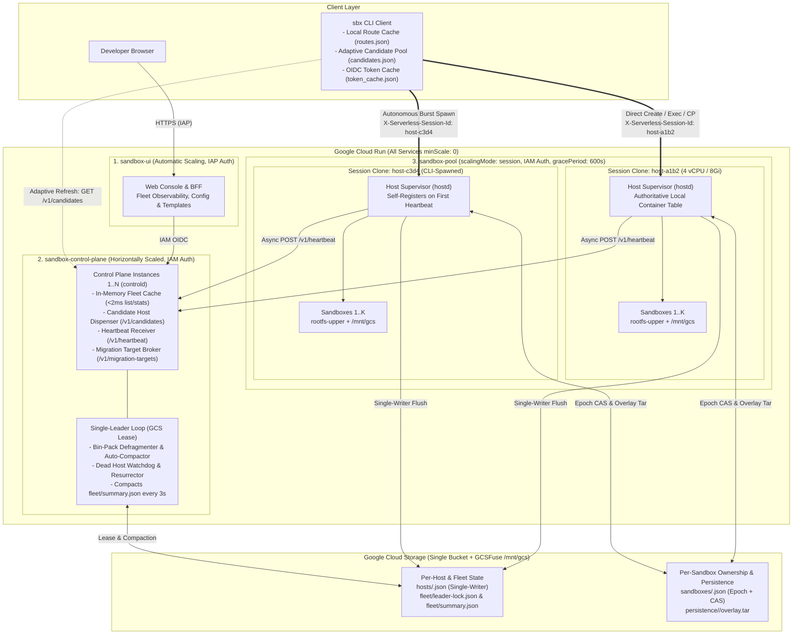
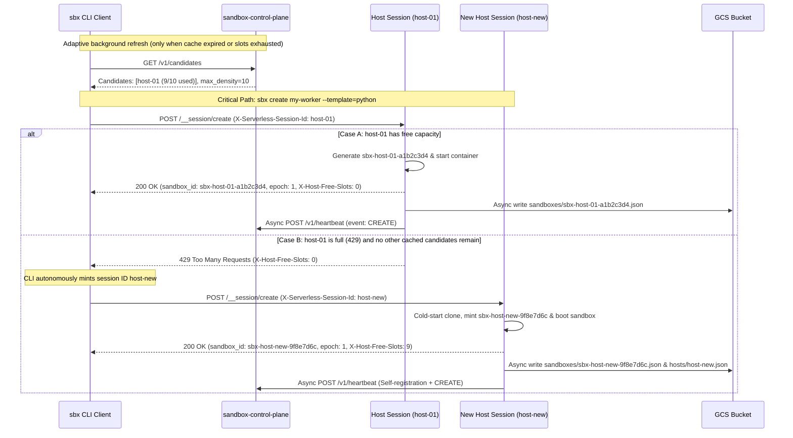

# Cloud Run Sandbox Dispenser — Architecture & Maintainer Guide

This document describes the internal system architecture, decentralized routing
protocols, consistency model, container runtime internals, and source code
layout of the **Cloud Run Sandbox Dispenser**.

> [!TIP]
> Looking to use `sbx`? See the **[Overview & Quick Start
> (README.md)](README.md)** and the **[User Guide & CLI Reference
> (USER_GUIDE.md)](USER_GUIDE.md)**.

[TOC]

## 1\. Three-Service Cloud Run Topology

The system is deployed as three Cloud Run services backed by a single Google
Cloud Storage bucket mounted via the Cloud Run GCSFuse CSI driver (`/mnt/gcs`)
and accessed via the GCS JSON HTTP API for atomic Compare-And-Swap
(`ifGenerationMatch`) operations:

1.  **`sandbox-pool` (`DISPENSER_MODE=hostd`, `scalingMode: session`, IAM Auth,
    `minScale: 0`, `gracePeriod: 600s`)**:
    *   Runs the session-isolated Host Supervisor (`hostd`), defaulting to **4
        vCPU and 8Gi RAM** per session clone (`--host-cpu=4 --host-memory=8Gi`).
    *   Each session clone (`host-<id>`) manages up to `max_density` (default
        `10`) isolated sandboxes using `CloudRunSandboxEngine`
        (`/usr/local/gcp/bin/sandbox --mode=container` when
        `/run/gcp/sandbox/sandbox.sock` is present) or `LocalProcessEngine`
        fallback.
2.  **`sandbox-control-plane` (`DISPENSER_MODE=controld`, `scalingMode:
    automatic`, IAM Auth, `minScale: 0`)**:
    *   Horizontally scalable coordinator. Every instance maintains a fast
        in-memory fleet cache hydrated from host heartbeats (`POST
        /v1/heartbeat`) and periodic background syncs of `fleet/summary.json`,
        serving `/v1/sandboxes`, `/v1/stats`, and `/v1/candidates` from RAM in
        under 2ms.
    *   A single GCS-leased leader (`fleet/leader-lock.json`) runs the Fleet
        Optimizer, bin-packing defragmenter, and dead-host watchdog.
3.  **`sandbox-ui` (`DISPENSER_MODE=ui`, `scalingMode: automatic`, IAP / Browser
    Auth, `minScale: 0`)**:
    *   Web console and Backend-For-Frontend (BFF) that authenticates browser
        users via Identity-Aware Proxy (IAP) and communicates with
        `sandbox-control-plane` using service-to-service IAM.

<!-- end list -->



-----

## 2\. Decentralized Creation & Direct-to-Host Routing Protocol

### Off-Critical-Path Sandbox Creation & Autonomous Session Spawning

Removing `sandbox-control-plane` from the synchronous creation path eliminates
central bottlenecks and ensures 100% creation availability even if the control
plane is scaling or restarting:

1.  **Candidate Pool Lookup**: The CLI reads open candidate hosts from
    `~/.cache/sbx/candidates.json` (refreshing from `GET /v1/candidates` only
    when the cache TTL expires or local free slots are exhausted).
2.  **Direct Host Creation**: The CLI sends `POST /__session/create` directly to
    `sandbox-pool` with header `X-Serverless-Session-Id: <candidate_host_id>`.
3.  **Host-Generated `sandbox_id`**: If the host has capacity (`active_sandboxes
    < max_density`), it reserves a slot, mints a globally unique `sandbox_id`
    (`sbx-<host_id>-<8hex>`), starts the sandbox container, writes
    `sandboxes/<sandbox_id>.json`, and returns `HTTP 200 OK` along with header
    `X-Host-Free-Slots`.
4.  **`HTTP 429` Fallback & Autonomous Session Spawning**: If the candidate host
    returns `HTTP 429 Too Many Requests` (`Host Full`) or `HTTP 503 Service
    Unavailable` (`Host Draining`), the CLI immediately tries the next
    candidate. When all known candidates are full (or during a cold burst from 0
    instances), the CLI autonomously mints a new session ID (`host-<random>`)
    and calls `sandbox-pool` directly. Cloud Run spins up the new session clone,
    which creates the sandbox and self-registers with `sandbox-control-plane` on
    its first heartbeat.

<!-- end list -->



### Direct Execution & `HTTP 409` Route Cache Self-Healing

Every subsequent operation (`exec`, `exec-stream`, `proxy` / `preview-url`,
`port-forward`, `cp`, `ssh`, `inspect`, `update`, `logs`, `suspend`, `resume`,
`copy`, `migrate`, `delete`) is routed directly from the CLI to the owning
`HostSession`:

1.  **Zero-Lookup Routing**: The CLI resolves the target host from
    `~/.cache/sbx/routes.json` or extracts `<host_id>` directly from the
    `sbx-<host_id>-<8hex>` sandbox ID (`ExtractInitialHostFromSandboxID`)
    without contacting the control plane.
2.  **`HTTP 409` Self-Healing**: If the sandbox was live-migrated (due to
    bin-packing compaction, `SIGTERM` drain, or crash recovery), the old host
    (or any queried host inspecting `sandboxes/<sandbox_id>.json`) returns `HTTP
    409 Conflict` (`Misdirected Sandbox`) with response header
    `X-Sandbox-Host-Session: <new_host_id>`.
3.  **Transparent Retry**: `CLIClient.CallSandboxEndpoint` automatically updates
    `routes.json` with `<new_host_id>` and retries the request transparently,
    completing the command with zero user-visible errors.

-----

## 3\. Two-Tier GCS State & Consistency Model

To prevent multi-instance lock contention in Google Cloud Storage while
supporting horizontal scaling of `sandbox-control-plane`, state is partitioned
into two tiers:

| Storage Tier                      | GCS Object Path                                                     | Writer & Concurrency Control                                                                                                                                                       | Consistency & Purpose                                                                                                                                                             |
| :-------------------------------- | :------------------------------------------------------------------ | :--------------------------------------------------------------------------------------------------------------------------------------------------------------------------------- | :-------------------------------------------------------------------------------------------------------------------------------------------------------------------------------- |
| **Tier 1: Per-Sandbox Ownership** | `sandboxes/<sandbox_id>.json`                                       | Written **exclusively** by the owning `HostSession` (or the Single-Leader Watchdog on crash recovery) using monotonic `epoch` + GCS `ifGenerationMatch` CAS on ownership transfer. | **Strongly Consistent**. Zero cross-sandbox contention even at 10,000+ concurrent creations.                                                                                      |
| **Tier 1: Per-Sandbox Overlay**   | `persistence/<sandbox_id>/overlay.tar`                              | Exported by the owning `HostSession` periodically (`periodic_sync_sec`), on `suspend`/`stop`, and prior to `SIGTERM` migration.                                                    | **RPO=0 on graceful migration/suspend**; bounded by `periodic_sync_sec` on hard crash.                                                                                            |
| **Tier 2: Per-Host State**        | `hosts/<host_id>.json`                                              | Single-writer per session clone (`host-<id>`), flushed periodically and on lifecycle events alongside `POST /v1/heartbeat`.                                                        | **Zero write contention** across hosts.                                                                                                                                           |
| **Tier 2: Compacted Fleet View**  | `fleet/summary.json`, `fleet/config.json`, `fleet/leader-lock.json` | Single-leader control plane (`ifGenerationMatch` lease on `leader-lock.json`) compacts all `hosts/*.json` into `fleet/summary.json` every 3 seconds.                               | **Eventual consistency (1–3s convergence)** across all `sandbox-control-plane` instances, enabling 1-object GET sync and sub-2ms in-memory `/v1/sandboxes` & `/v1/stats` queries. |

-----

## 4\. Runtime, Persistence & High-Availability Internals

*   **Cloud Run Sandbox Runtime & Local Runtime Engines (`runtime.go`)**:
    *   When `/usr/local/gcp/bin/sandbox` and `/run/gcp/sandbox/sandbox.sock`
        are present on a Cloud Run Gen2 instance, `hostd` uses `CloudRunSandboxEngine`
        to launch isolated micro-containers (`sandbox --mode=container run
        --detach --write`), export writable overlays (`sandbox tar <id> --file
        <path>`), import overlays (`--import-tar`), and perform same-host
        Copy-on-Write forks (`sandbox fork`).
    *   In local test environments or projects without Cloud Run Sandbox Runtime templates
        enabled, `hostd` transparently falls back to `LocalProcessEngine` using
        isolated per-sandbox root directories.
*   **Unprivileged PostgreSQL 16 Persistence (`libfakeuid.so` + `tcpproxy`)**:
    *   Cloud Run Sandbox Runtime containers run inside a single-UID user namespace where
        `initdb` and `postgres` normally refuse to run as `UID 0` or fail on
        `chown`.
    *   `CloudRunSandboxEngine` unpacks an embedded `LD_PRELOAD` shared library
        (`/mnt/shared/bin/libfakeuid.so`) that maps `UID 0 -> UID 999` and
        `tcpproxy` (`/mnt/shared/bin/tcpproxy`) so PostgreSQL 16 runs cleanly
        with `PGDATA=/pgdata/data` stored inside the container's writable
        `rootfs-upper` overlay.
    *   Prior to suspend or live migration, `Quiesce()` executes a clean
        `CHECKPOINT` and `pg_ctl -D /pgdata/data -m fast stop` so the exported
        `overlay.tar` is transactionally consistent (`RPO=0`).
*   **Scale-to-Zero Instance State Signaling (`/sys/class/instance/state`) &
    Idle Auto-Suspend**:
    *   Both `hostd` and `controld` dynamically write `"busy"` to
        `/sys/class/instance/state` while hosting active sandboxes
        or holding the fleet leader lock while sandboxes exist, and write
        `"idle"` when active sandboxes reach zero so Cloud Run scales idle
        session clones and control-plane instances down to zero.
    *   **Configurable Auto-Suspend on No Traffic (Off by Default)**: Idle
        auto-suspend is disabled by default (`idle_timeout_sec: 0` and
        `default_idle_timeout_sec: 0`) so long-running background sandboxes are
        never unexpectedly suspended. Users can opt in per sandbox
        (`--idle-timeout=<SEC>` / `--auto-suspend=<SEC>`) or fleet-wide (`sbx
        config set --default-idle-timeout=<SEC>`), with explicit per-sandbox
        `--idle-timeout=0` (`disable_auto_suspend: true`) overriding a non-zero
        fleet default.
    *   **Active Connection Tracking (`activeConns`)**: `HostServer` tracks
        in-flight connections per sandbox (`beginSandboxActivity` /
        `touchSandboxActivity` / `endSandboxActivity`) across `exec`,
        `exec-stream`, `cp`, `proxy`, and `port-forward` so a sandbox with an
        open stream or active HTTP/TCP connection is never suspended mid-flight.
    *   **PostgreSQL Scale-to-Zero & Auto-Resume**: When an idle-timeout sandbox
        (including `postgres`) has `0` active connections for `IdleTimeoutSec`,
        `hostd` runs `Quiesce()` (`CHECKPOINT` + `pg_ctl stop`), exports the
        overlay tarball to GCS (`persistence/<id>/overlay.tar`), marks the
        sandbox `SUSPENDED`, and—if the host has `0` remaining sandboxes—calls
        `retireEmptyHost` to scale the host to `0`. Any subsequent `exec`,
        `exec-stream`, `/proxy/` HTTP request, or `port-forward` connection
        automatically hydrates the overlay, restarts PostgreSQL,
        `background_commands`, and `/workspace/.sbx_init.sh`, and serves the
        request with `RPO=0`.
*   **Real-Time SSE Streaming (`POST /__session/exec-stream`) & Per-Sandbox
    Preview URLs (`/proxy/<id>/<port>/*`)**:
    *   `POST /__session/exec-stream` resolves or auto-hydrates the target
        sandbox *before* committing `200 OK` (`Content-Type:
        text/event-stream`), preserving `HTTP 409` (`X-Sandbox-Host-Session`)
        route self-healing, and streams `ExecStreamEvent` JSON frames (`start`,
        `stdout`, `stderr`, `exit`, `error`) with immediate `http.Flusher`
        flushes.
    *   `/proxy/<id_or_name>/<port>/<subpath>` (on `controld`, `ui`, and
        `hostd`) and `/__session/port-forward` route HTTP, WebSocket (`Upgrade:
        websocket`), and raw TCP (`Upgrade: tcp`) traffic into the sandbox's
        listening port via `SandboxEngine.DialSandboxPort` (which retries
        dialing for up to 5s after Wake-on-HTTP auto-resume so newly restarted
        background servers have time to bind their port).
*   **600s Graceful `SIGTERM` Evacuation & Watchdog Crash Recovery**:
    *   `sandbox-pool` configures `terminationGracePeriodSeconds: 600`. When a
        host receives `SIGTERM` (or detects a `target_revision` rollout or
        `DRAIN` command), `hostd` requests destination hosts from `POST
        /v1/migration-targets` (or autonomously mints `host-<uuid>` sessions if
        the control plane is unreachable), exports each sandbox's overlay
        tarball, and calls `POST /__internal/hydrate` on the target host.
    *   If a host clone suffers an ungraceful `SIGKILL` crash and misses
        heartbeats for `heartbeat_timeout_sec` (default `15s`), the
        control-plane leader's watchdog marks the host `DEAD`, increments the
        sandbox's `epoch` via CAS on `sandboxes/<sandbox_id>.json`, and hydrates
        the sandbox onto a healthy host from its latest periodic overlay
        snapshot.

-----

## 5\. Thin-Client & Multi-Language SDK Contract (CLI, Go, Python)

Starting in `v1.2.0`, all server-side orchestration and domain business logic
lives on `sandbox-control-plane` (`controld.go`) and `sandbox-pool`
(`hostd.go`), while clients (`sbx` CLI, Go `CLIClient`, Python SDK, etc.) remain
thin, stateless HTTP/JSON + distributed-routing wrappers.

### Division of Responsibilities: Thin Client vs. Server Components

| Responsibility                                           | Where It Runs                     | Protocol / Endpoint                                                                                                                                                                                                                                                                                                                                                                                                                                   |
| :------------------------------------------------------- | :-------------------------------- | :---------------------------------------------------------------------------------------------------------------------------------------------------------------------------------------------------------------------------------------------------------------------------------------------------------------------------------------------------------------------------------------------------------------------------------------------------- |
| **Candidate Host Selection & `429`/`503` Fallback**      | **Client** (`CLIClient`)          | Reads `~/.cache/sbx/candidates.json` (Best-Fit ordering), calls `POST /__session/create` directly on `sandbox-pool`, falls back across candidates on `429`/`503`, and autonomously mints `host-<random>` when all candidates are full.                                                                                                                                                                                                                |
| **Direct Session Routing & `HTTP 409` Self-Healing**     | **Client** (`CLIClient`)          | Resolves `<sandbox_id> -> <host_id>` via `routes.json` or `ExtractInitialHostFromSandboxID` and heals stale routes automatically when a host returns `HTTP 409 Conflict` with `X-Sandbox-Host-Session: <new_host_id>`.                                                                                                                                                                                                                                |
| **Ambiguous Name Resolution (`?resolve=unique`)**        | **Server** (`controld`)           | `GET /v1/sandboxes?name=<NAME>&resolve=unique` returns `HTTP 409 Conflict` with all matching `sandbox_id`s if multiple active sandboxes share `<NAME>`, preventing clients from duplicating filtering logic.                                                                                                                                                                                                                                          |
| **Template Creation from Live Sandbox (`from_sandbox`)** | **Server** (`controld` + `hostd`) | `POST /v1/templates` with `{"name": "...", "from_sandbox": "<id_or_name>"}` resolves the sandbox, snapshots its overlay (`snap-tpl-<name>`) on the owning host, and registers the template in a single server-side operation.                                                                                                                                                                                                                         |
| **Host Sizing Rollout (`host_cpu` / `host_memory`)**     | **Server** (`controld`)           | `POST /v1/config` validates CPU/memory pairs, updates `fleet/config.json`, and reconciles the `sandbox-pool` Cloud Run service sizing (`gcloud run services update sandbox-pool`) server-side.                                                                                                                                                                                                                                                        |
| **Server-Side Fleet Deployment Reconciliation**          | **Server** (`controld`)           | `POST /v1/deploy` reconciles `sandbox-pool` and `sandbox-ui` Cloud Run services, wires mutual URLs (`CONTROL_PLANE_URL`, `POOL_SERVICE_URL`), and persists `fleet/config.json`.                                                                                                                                                                                                                                                                       |
| **Security Policy & Live IAP / IAM Reconciliation**      | **Server** (`controld` + `ui`)    | `GET /v1/security/policy` and `POST /v1/security/policy` persist `fleet/security-policy.json`, reconcile live Cloud IAP (`roles/iap.httpsResourceAccessor` on `sandbox-ui`) and Cloud Run IAM (`roles/run.invoker` on `sandbox-control-plane` and `sandbox-pool`), and enforce the `self_revocation_forbidden` safeguard so the signed-in caller (`X-Goog-Authenticated-User-Email`) or protected system service accounts cannot lock themselves out. |
| **Server-Side Log Tailing (`?tail=N`)**                  | **Server** (`hostd` & `controld`) | `GET /__session/logs?sandbox_id=<id>&tail=<N>` slices the last `N` lines on the server before returning the payload.                                                                                                                                                                                                                                                                                                                                  |

### Cloud IAP & Backend IAM Security Policy (`GET /v1/security/policy` & `POST /v1/security/policy`)

`sandbox-ui` is deployed with native Cloud Run IAP enabled
(`run.googleapis.com/iap-enabled: 'true'`), and `deploy.sh` / `POST /v1/deploy`
automatically seeds the deploying user (`gcloud config get-value account`, e.g.
`user:admin@example.com`) into both:

*   **UI Access (`ui_access_members`)**: Granted
    `roles/iap.httpsResourceAccessor` (via `gcloud iap web
    add-iam-policy-binding --resource-type=cloud-run --service=sandbox-ui`) and
    `roles/run.invoker` on `sandbox-ui`.
*   **Backend Access (`backend_access_members`)**: Granted `roles/run.invoker`
    on `sandbox-control-plane` and `sandbox-pool`.

When an administrator updates principals in the **Security & IAM / IAP** tab of
`sandbox-ui` (`POST /v1/security/policy` with actions `add_ui_member`,
`remove_ui_member`, `add_backend_member`, `remove_backend_member`, or
`set_iap_enabled`):

1.  **Self-Revocation & System Account Safeguard
    (`self_revocation_forbidden`)**: `controld` resolves the caller's identity
    from `X-Goog-Authenticated-User-Email` (or OIDC token claims) and rejects
    any request (`HTTP 400 Bad Request`, `error: "self_revocation_forbidden"`)
    that attempts to remove the caller's own principal or protected system
    service accounts (`*-compute@developer.gserviceaccount.com`,
    `*@gcp-sa-iap.iam.gserviceaccount.com`).
2.  **Persistence & Live Reconciliation**: Validated changes are written
    atomically to `fleet/security-policy.json` in GCS and applied asynchronously
    to Cloud IAP and Cloud Run IAM via `applyCloudIAMBindingChange`.

### Client Version Negotiation & `HTTP 426 Upgrade Required`

To keep multi-language clients (`sbx-cli/go`, `sbx-sdk-python`, `sbx-ui`)
synchronized with server protocol evolutions:

1.  **Request Headers**: Every client request sends:

    *   `X-Sbx-Client-Version: 1.2.0` (semver string)
    *   `X-Sbx-Client-Type: sbx-cli/go` (or `sbx-sdk-python`, `sbx-ui`, etc.)

2.  **Response Headers**: Both `sandbox-control-plane` and `sandbox-pool`
    attach:

    *   `X-Sbx-Server-Version: 1.2.0`
    *   `X-Sbx-Min-Client-Version: <min_client_version>` (configured in
        `FleetConfig`, default `1.0.0`)

3.  **Minimum Version Enforcement (`HTTP 426 Upgrade Required`)**: If a client
    presents an `X-Sbx-Client-Version` older than `FleetConfig.MinClientVersion`
    (convertible dynamically via `sbx config set
    --min-client-version=<SEMVER>`), the server rejects the request with `HTTP
    426 Upgrade Required`:

    ```json
    {
      "error": "client_upgrade_required",
      "client_version": "1.0.0",
      "min_client_version": "1.2.0",
      "server_version": "1.2.0",
      "message": "sbx client v1.0.0 is older than minimum required version v1.2.0; please rebuild or upgrade your sbx client"
    }
    ```

-----

## 6\. Repository Structure & Running Tests

All source files live in the root directory of the repository:

| File                                                       | Purpose                                                                                                                                                                                                                                                                                                                                                                                                                                                                                                        |
| :--------------------------------------------------------- | :------------------------------------------------------------------------------------------------------------------------------------------------------------------------------------------------------------------------------------------------------------------------------------------------------------------------------------------------------------------------------------------------------------------------------------------------------------------------------------------------------------- |
| [`main.go`](main.go)                                       | Unified entrypoint supporting `DISPENSER_MODE=hostd` (`sandbox-pool` daemon), `DISPENSER_MODE=controld` (`sandbox-control-plane` daemon), `DISPENSER_MODE=ui` (`sandbox-ui` daemon), and the default `sbx` CLI mode, including `SIGTERM` graceful evacuation hooks.                                                                                                                                                                                                                                            |
| [`dispenser.go`](dispenser.go)                             | Core domain models (`SandboxRecord`, `HostRecord`, `FleetConfig`, `FleetSummary`, `TemplateSpec`, `SnapshotRecord`), protocol version negotiation (`DispenserVersion`, `CompareSemver`), distributed ID generation (`sbx-<host>-<8hex>`), strict ID/path validation (`ValidateID`, `SafeResolvePath`), `Store` interface (`MemoryStore` and `GCSStore` with `ifGenerationMatch` CAS), and OIDC/OAuth2 token caching (`token_cache.json`).                                                                      |
| [`runtime.go`](runtime.go)                                 | `SandboxEngine` implementations: `CloudRunSandboxEngine` (`/usr/local/gcp/bin/sandbox --mode=container` with embedded `libfakeuid.so`, `tcpproxy`, and `start-pg.sh` for PostgreSQL 16) and `LocalProcessEngine` (isolated directory subshells for hermetic tests and non-Cloud Run Sandbox Runtime environments), plus `/sys/class/instance/state` scale-to-zero signaling.                                                                                                                                                           |
| [`hostd.go`](hostd.go)                                     | Session-isolated Host Supervisor (`HostServer`) handling `/__session/create`, `/__session/exec`, `/__session/exec-stream`, `/proxy/<id>/<port>/*`, `/__session/port-forward`, `/__session/cp`, `/__session/update`, `/__session/suspend`, `/__session/resume`, `/__session/copy`, `/__session/migrate`, `/__session/snapshot`, `/__session/logs` (with `?tail=N`), `/__session/delete`, and `/__internal/hydrate`, plus client version enforcement (`HTTP 426`), periodic overlay sync, and idle auto-suspend. |
| [`controld.go`](controld.go)                               | Horizontally scalable Control Plane (`ControlPlaneServer`) serving `/v1/candidates`, `/v1/heartbeat`, `/v1/sandboxes` (including `?resolve=unique`), `/v1/hosts`, `/v1/stats`, `/v1/config` (with server-side host CPU/RAM rollout), `/v1/templates` (with server-side `from_sandbox` snapshotting), `/v1/snapshots`, `/v1/migration-targets`, `/v1/compact`, `/v1/deploy`, `/proxy/<id_or_name>/<port>/*`, and `/__session/port-forward`, plus the GCS-leased Single-Leader Optimizer & Dead-Host Watchdog.   |
| [`ui.go`](ui.go)                                           | IAP-authenticated Web Console and Backend-For-Frontend (`UIServer`) with CSRF protection, strict Content-Security-Policy headers, `/api/sandboxes/exec-stream` live SSE streaming, `/proxy/<id_or_name>/<port>/*` (HTTP + WebSocket) and `/__session/port-forward` proxying, and service-to-service IAM forwarding to `sandbox-control-plane`.                                                                                                                                                                 |
| [`cli.go`](cli.go)                                         | Thin decentralized `CLIClient` and `RunCLI` command parser implementing `sbx init`, `sbx version`, `sbx ui`, `sbx exec --stream`, `sbx preview-url`, `sbx port-forward`, adaptive candidate caching (`candidates.json`), route/name resolution (`routes.json`), `HTTP 429` candidate fallback, autonomous session spawning, and `HTTP 409` route self-healing across all CLI subcommands.                                                                                                                      |
| [`dispenser_test.go`](dispenser_test.go)                   | Hermetic unit and integration test suite covering decentralized creation, candidate exhaustion, autonomous host spawning, `HTTP 409` route self-healing, live migration, watchdog crash recovery, bin-packing compaction, CoW cloning, snapshots, custom templates, SSE streaming, preview URLs, idle auto-suspend, and path-traversal security boundaries.                                                                                                                                          |
| [`service-pool.yaml`](service-pool.yaml)                   | Cloud Run service manifest for `sandbox-pool` (`scalingMode: session`, `sandboxLauncher: true`, GCSFuse `/mnt/gcs`, `terminationGracePeriodSeconds: 600`, default `4` vCPU / `8Gi` RAM).                                                                                                                                                                                                                                                                                                                       |
| [`service-control-plane.yaml`](service-control-plane.yaml) | Cloud Run service manifest for `sandbox-control-plane` (`minScale: 0`, `maxScale: 10`, Gen2 execution environment).                                                                                                                                                                                                                                                                                                                                                                                            |
| [`service-ui.yaml`](service-ui.yaml)                       | Cloud Run service manifest for `sandbox-ui` (`minScale: 0`, IAP-compatible web dashboard).                                                                                                                                                                                                                                                                                                                                                                                                                     |
| [`Dockerfile`](Dockerfile)                                 | Multi-stage Docker build compiling the static `sbx` Go binary and packaging Ubuntu 24.04 with Python 3, Node.js, Git, and PostgreSQL 16.                                                                                                                                                                                                                                                                                                                                                                       |
| [`deploy.sh`](deploy.sh)                                   | Automated Cloud Build + Cloud Run deployment script.                                                                                                                                                                                                                                                                                                                                                                                                                                                           |
| [`Makefile`](Makefile) & [`go.mod`](go.mod)                | Standard Go module definition and build/test targets (`make build`, `make test`).                                                                                                                                                                                                                                                                                                                                                                                                                              |

### Building and Running Unit Tests

Build the `sbx` CLI and run the hermetic unit and integration test suite using
standard Go tooling:

```shell
# Run the full hermetic unit and integration test suite
go test -v ./...

# Build the `sbx` CLI binary
go build -trimpath -ldflags="-s -w" -o sbx .
```
