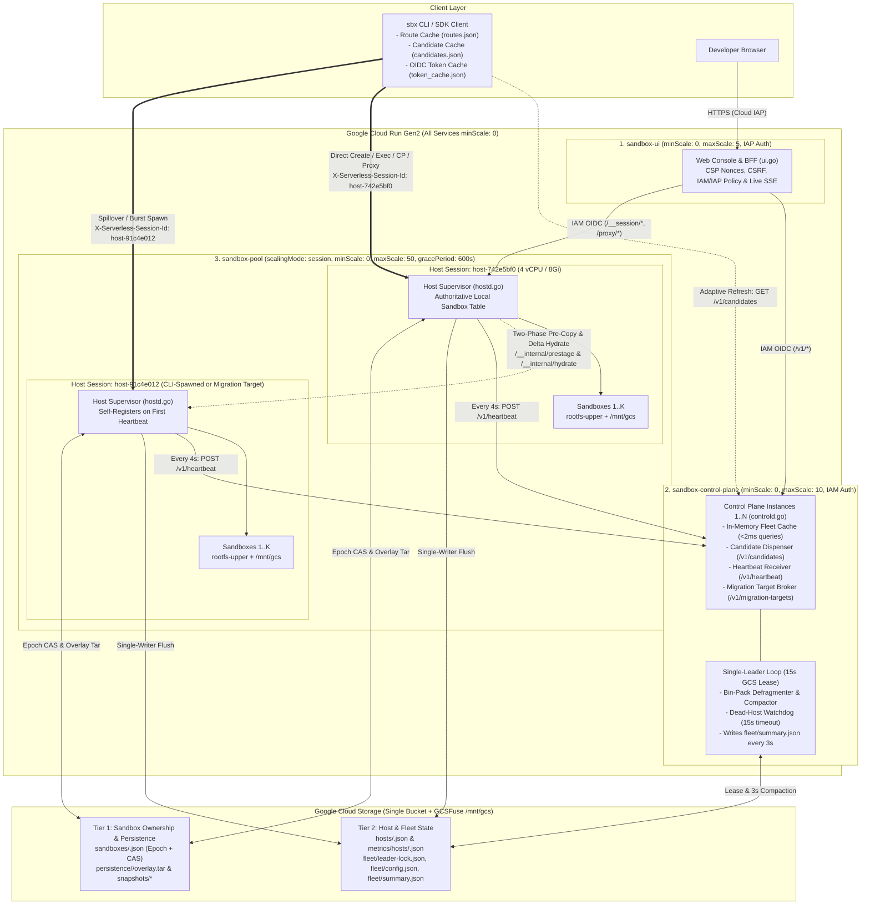
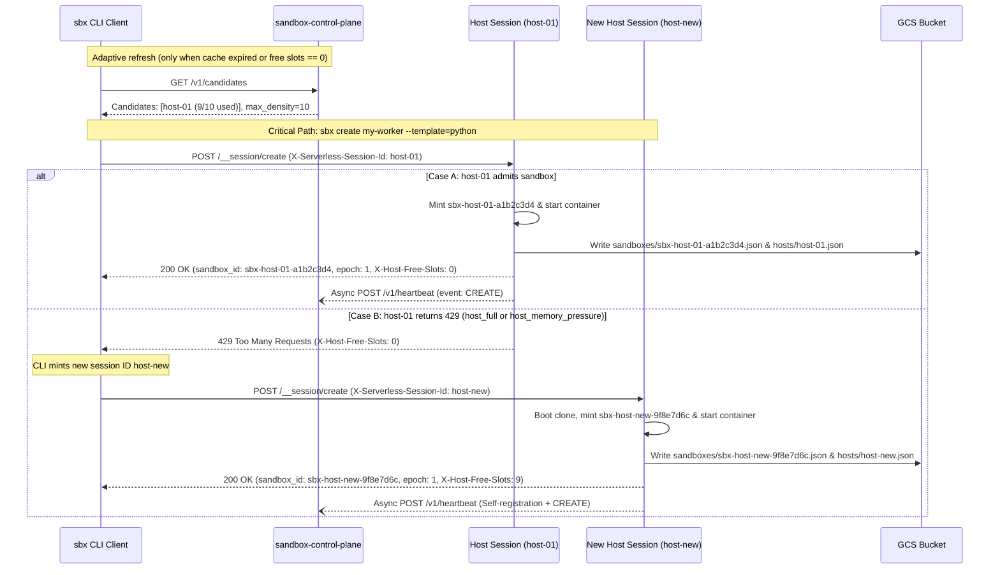
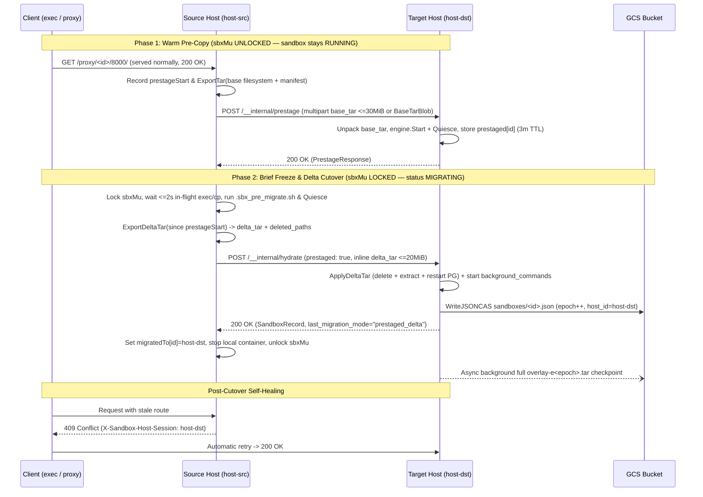

# Cloud Run Sandbox Dispenser — Architecture & Maintainer Guide

**Navigation:** [Overview & Quick Start (README.md)](README.md) ·
[User Guide & CLI Reference (USER_GUIDE.md)](USER_GUIDE.md) ·
**Architecture & Maintainer Guide (ARCHITECTURE.md)** ·
[Overload Protection (OVERLOAD_PROTECTION.md)](OVERLOAD_PROTECTION.md)

*Protocol & Server Version: `v1.2.0` (`DefaultMinClientVersion: 1.0.0`)*

This document describes the three-service Cloud Run topology, decentralized session routing
protocols, two-phase pre-copy live migration, two-tier GCS consistency model, runtime isolation
internals, security controls, and HTTP API surface of **Cloud Run Sandbox Dispenser** (`sbx`).

## Contents

- [1. Three-Service Cloud Run Topology](#1-three-service-cloud-run-topology)
  - [Core Terminology](#core-terminology)
- [2. Decentralized Creation, Routing & Live Migration Protocols](#2-decentralized-creation-routing--live-migration-protocols)
  - [2.1 Off-Critical-Path Sandbox Creation & Autonomous Session Spawning](#21-off-critical-path-sandbox-creation--autonomous-session-spawning)
  - [2.2 Direct Execution & `HTTP 409` Route Cache Self-Healing](#22-direct-execution--http-409-route-cache-self-healing)
  - [2.3 Two-Phase Pre-Copy Live Migration](#23-two-phase-pre-copy-live-migration)
- [3. Two-Tier GCS State & Consistency Model](#3-two-tier-gcs-state--consistency-model)
- [4. Runtime, Isolation & Scale-to-Zero Internals](#4-runtime-isolation--scale-to-zero-internals)
  - [4.1 Isolation & Trust Model (`cloudrun` vs. `local`)](#41-isolation--trust-model-cloudrun-vs-local)
  - [4.2 Unprivileged PostgreSQL 16 Persistence (`libfakeuid.so` + `tcpproxy`)](#42-unprivileged-postgresql-16-persistence-libfakeuidso--tcpproxy)
  - [4.3 Scale-to-Zero Signaling & Idle Auto-Suspend](#43-scale-to-zero-signaling--idle-auto-suspend)
  - [4.4 Real-Time SSE Streaming & Preview URLs](#44-real-time-sse-streaming--preview-urls)
  - [4.5 600s Graceful `SIGTERM` Evacuation & Watchdog Crash Recovery](#45-600s-graceful-sigterm-evacuation--watchdog-crash-recovery)
- [5. Thin-Client Contract, Security & Version Negotiation](#5-thin-client-contract-security--version-negotiation)
  - [5.1 Division of Responsibilities (Client vs. Server)](#51-division-of-responsibilities-client-vs-server)
  - [5.2 Web Console Security (`ui.go`) & Cloud IAP / IAM Reconciliation](#52-web-console-security-uigo--cloud-iap--iam-reconciliation)
  - [5.3 Client Version Negotiation & `HTTP 426 Upgrade Required`](#53-client-version-negotiation--http-426-upgrade-required)
- [6. System Timers & Defaults Reference](#6-system-timers--defaults-reference)
- [7. Repository Structure, HTTP API Surface & Running Tests](#7-repository-structure-http-api-surface--running-tests)
  - [7.1 Source File Layout](#71-source-file-layout)
  - [7.2 Complete HTTP API Surface](#72-complete-http-api-surface)
  - [7.3 Building and Running Unit Tests](#73-building-and-running-unit-tests)

---

## 1. Three-Service Cloud Run Topology

The system is deployed as three scale-to-zero Cloud Run Gen2 services backed by a single Google
Cloud Storage (GCS) bucket mounted via the Cloud Run GCSFuse CSI driver (`/mnt/gcs`) and accessed
via the GCS JSON HTTP API for atomic Compare-And-Swap (`ifGenerationMatch`) operations:

1. **`sandbox-pool` (`DISPENSER_MODE=hostd`, `scalingMode: session`, IAM Auth, `minScale: 0`,
   `maxScale: 50`, `terminationGracePeriodSeconds: 600`)**:
   * Runs the session-isolated Host Supervisor (`hostd`), defaulting to **4 vCPU and 8Gi RAM** per
     host instance (`--host-cpu=4 --host-memory=8Gi`).
   * Each host session (`host-<8hex>`) manages up to `max_density` (default `10`, for up to 500
     concurrent sandboxes across 50 hosts by default) isolated sandboxes using
     `CloudRunSandboxEngine` (`engine_type: "cloudrun"`) or `LocalProcessEngine`
     (`engine_type: "local"`).
2. **`sandbox-control-plane` (`DISPENSER_MODE=controld`, `scalingMode: automatic`, IAM Auth,
   `minScale: 0`, `maxScale: 10`)**:
   * Horizontally scalable coordinator. Every instance maintains an in-memory fleet cache hydrated
     from host heartbeats (`POST /v1/heartbeat` every 4s) and background syncs of
     `fleet/summary.json`, serving `/v1/sandboxes`, `/v1/stats`, and `/v1/candidates` from memory in
     under 2ms.
   * A single GCS-leased leader (`fleet/leader-lock.json`, 15s lease TTL) runs the Fleet Optimizer,
     bin-packing defragmenter, dead-host watchdog, and `fleet/summary.json` compactor (every 3s).
3. **`sandbox-ui` (`DISPENSER_MODE=ui`, `scalingMode: automatic`, Cloud IAP + IAM Auth,
   `minScale: 0`, `maxScale: 5`)**:
   * Web Console and Backend-for-Frontend (BFF) that authenticates browser users via Cloud
     Identity-Aware Proxy (IAP) and communicates with both `sandbox-control-plane` (`/v1/*`) and
     `sandbox-pool` (`/__session/*`, `/proxy/*`) using service-to-service Cloud Run IAM.

### Core Terminology

* **Host Session (`host-<8hex>`)**: A single Cloud Run session-affinity instance in `sandbox-pool`
  addressed via header `X-Serverless-Session-Id: host-<8hex>`.
* **Cloud Run Sandbox Runtime**: The micro-container runtime
  (`/usr/local/gcp/bin/sandbox --mode=container` communicating over `/run/gcp/sandbox/sandbox.sock`)
  enabled on `sandbox-pool` when `sandboxLauncher: true` is active.
* **Writable Overlay (`rootfs-upper`)**: The per-sandbox writable filesystem layer containing
  `/workspace`, `/persistent`, and PostgreSQL `/pgdata/data`, exported as
  `persistence/<sandbox_id>/overlay.tar`.
* **Backend-for-Frontend (BFF)**: The server-side proxy layer in `sandbox-ui` (`ui.go`) that
  attaches Cloud Run IAM OIDC tokens on behalf of browser sessions so raw bearer tokens are never
  exposed to client-side JavaScript.



---

## 2. Decentralized Creation, Routing & Live Migration Protocols

### 2.1 Off-Critical-Path Sandbox Creation & Autonomous Session Spawning

Removing `sandbox-control-plane` from the synchronous creation path avoids central proxy bottlenecks
and allows sandbox creation to proceed even while the control plane is scaling or restarting:

1. **Candidate Pool Lookup**: The CLI reads open candidate hosts from
   `~/.cache/sbx/candidates.json` (refreshing from `GET /v1/candidates` only when the adaptive TTL
   expires or local free slots are exhausted). `GET /v1/candidates` excludes hosts in
   `ADMISSION_BLOCKED` or `HOT_SHEDDING` overload states (see
   [OVERLOAD_PROTECTION.md](OVERLOAD_PROTECTION.md)).
2. **Direct Host Creation**: The CLI sends `POST /__session/create` directly to `sandbox-pool` with
   header `X-Serverless-Session-Id: <candidate_host_id>`.
3. **Host-Generated `sandbox_id` & Synchronous Ownership Record**: If the host has capacity
   (`active_sandboxes < max_density` and not memory-blocked), `handleCreate` reserves a slot, mints
   a globally unique `sandbox_id` (`sbx-<host_id>-<8hex>`), starts the sandbox container, exports
   the initial overlay if `persistent=true`, **synchronously** writes
   `sandboxes/<sandbox_id>.json`, `hosts/<host_id>.json`, and `metrics/hosts/<host_id>.json` to the
   store, and returns `HTTP 200 OK` with header `X-Host-Free-Slots`. It then sends
   `POST /v1/heartbeat` to `sandbox-control-plane` asynchronously in a background goroutine.
4. **`HTTP 429` / `503` Fallback & Autonomous Session Spawning**: If the candidate host returns
   `HTTP 429 Too Many Requests` (`{"error": "host_full"}` or `{"error": "host_memory_pressure"}`) or
   `HTTP 503 Service Unavailable` (`{"error": "host_draining"}`), the CLI immediately tries the next
   cached candidate. When all known candidates are full (or during a cold start from 0 instances),
   the CLI autonomously mints a new session ID (`host-<8hex>`) and calls `sandbox-pool` directly.
   Cloud Run boots a new session clone, which creates the sandbox and self-registers with
   `sandbox-control-plane` on its heartbeat.



### 2.2 Direct Execution & `HTTP 409` Route Cache Self-Healing

Subsequent operations (`exec`, `exec-stream`, `proxy`, `port-forward`, `cp`, `ssh`, `inspect`,
`update`, `logs`, `suspend`, `resume`, `copy`, `migrate`, `delete`) route directly from the client
to the owning `HostSession`:

1. **Zero-Lookup Routing**: When passed a distributed `sandbox_id` (`sbx-<host_id>-<8hex>`), the
   client resolves the target host from `~/.cache/sbx/routes.json` or extracts `<host_id>` directly
   via `ExtractInitialHostFromSandboxID` without contacting the control plane.
2. **`HTTP 409` Self-Healing**: If the sandbox was live-migrated (due to `sbx migrate`, bin-packing
   compaction, hot-host shedding, `SIGTERM` drain, or crash recovery), the previous host (or any
   queried host reading `sandboxes/<sandbox_id>.json`) returns `HTTP 409 Conflict`
   (`{"error": "misdirected_sandbox"}`) with response header `X-Sandbox-Host-Session: <new_host_id>`.
3. **Transparent Retry**: `CLIClient.CallSandboxEndpoint` updates `routes.json` with
   `<new_host_id>` and retries the request once transparently.

### 2.3 Two-Phase Pre-Copy Live Migration

When a running sandbox is live-migrated between hosts (`liveMigrateSandbox`, invoked by
`handleMigrate`, `DrainAndEvacuate`, and `checkResourceOverloadAndShed` in
[`hostd.go`](hostd.go)), `hostd` uses **Two-Phase Pre-Copy + Direct Host-to-Host Delta Streaming**
(`MigrationModePrestagedDelta = "prestaged_delta"`) so the sandbox continues serving `exec` and
`/proxy` traffic while the base filesystem transfer and destination container warm-up complete in
the background:

1. **Phase 1 — Warm Pre-Copy (`POST /__internal/prestage`, alias `/__session/prestage`, `0ms`
   Freeze)**:
   * Without acquiring `sbxMu` and while the sandbox remains `RUNNING` on the source host, the
     source host records `prestageStart` and exports a base tarball of the sandbox filesystem
     (`engine.ExportTar`, recording a file manifest of paths, sizes, modes, types, and mtimes).
   * The source host sends `PrestageRequest` to the destination host
     (`X-Serverless-Session-Id: <target_host_id>`, `prestageTimeout: 5m`). Base tarballs up to
     **30 MiB** (`maxInlinePrestageBytes`, below Cloud Run's 32 MiB HTTP/1 request cap) stream
     directly as `multipart/form-data`; base tarballs above 30 MiB stage through a temporary Store
     blob (`BaseTarBlob`, up to a 16 GiB received cap).
   * The destination host unpacks the base tarball, starts/warms the container via `engine.Start`,
     calls `engine.Quiesce` (stopping PostgreSQL in the prestaged copy until the Phase 2 delta
     lands), emits a `PRESTAGE` event, and stores the warm entry in `h.prestaged[sandboxID]` with a
     **3-minute** expiration TTL (`prestageTTL: 3m`). A host holding a prestaged entry does not
     count it as an active sandbox or own it in GCS yet, and suppresses empty auto-retirement while
     the entry is unexpired.
2. **Phase 2 — Brief Freeze & Direct Delta Cutover (`POST /__internal/hydrate` with
   `prestaged: true`)**:
   * The source host acquires `sbxMu.Lock()`, re-verifies the sandbox is still `RUNNING` in
     `h.sandboxes`, records `freezeStart`, and sets status to `MIGRATING` (which holds incoming
     `/proxy` requests rather than dropping them).
   * The source host waits up to **2 seconds** (`migrationInflightWait: 2s`) for any in-flight
     `exec` or `cp` calls to finish so their writes land in the delta.
   * The source host runs `/workspace/.sbx_pre_migrate.sh` (if present) and, for `postgres`
     sandboxes, calls `engine.Quiesce` (`CHECKPOINT` + clean `pg_ctl -D /pgdata/data -m fast stop`).
   * The source host calls `engine.ExportDeltaTar(ctx, rec, prestageStart, ...)` to package only
     files added or modified since Phase 1 (comparing size, mode, type, and mtime against the base
     manifest plus a `prestageStart - 2s` mtime window) along with `DeletedPaths`.
   * The source host sends `HydrateRequest{Prestaged: true, DeltaTar, DeletedPaths}` to
     `POST /__internal/hydrate` (alias `/__session/hydrate`) on the destination host. Deltas up to
     **20 MiB** (`maxInlineDeltaBytes`) travel inline in the HTTP request (larger deltas use
     `DeltaTarBlob`), bypassing GCS upload/download during the cutover for typical workloads.
   * The destination host (`hydrateSandboxInternal`) runs `engine.ApplyDeltaTar` (deleting
     `DeletedPaths`, extracting modified files, and restarting PostgreSQL), launches
     `background_commands` and `/workspace/.sbx_init.sh`, increments `epoch` via GCS CAS
     (`ifGenerationMatch`) on `sandboxes/<sandbox_id>.json`, marks the sandbox `RUNNING`, and
     asynchronously checkpoints the full `overlay-e<epoch>.tar` to GCS in a background goroutine.
   * The source host sets `h.migratedTo[sandboxID] = hydrated.HostID`, stops its local container,
     and releases `sbxMu`.
3. **Downtime Accounting, Events & Automatic Fallback (`gcs_full`)**:
   * `SandboxRecord` records `last_migration_freeze_ms` (full Phase 2 freeze timed from the source
     host's `freezeStart`), `last_migration_total_ms` (Phase 1 + Phase 2 wall-clock),
     `last_migration_mode` (`"prestaged_delta"` or `"gcs_full"`), and increments
     `total_downtime_ms` by `last_migration_freeze_ms`. Both source and target emit `MIGRATE` (or
     `HOT_MIGRATE`) events with `mode=`, `freeze_ms=`, and `total_ms=` (plus `delta_bytes` and
     `deleted_paths` on the target).
   * If Phase 1 pre-staging, delta export, or delta apply fails—or if the target lost its warm copy
     (`HTTP 412 Precondition Failed`, `ErrNotPrestaged`)—`liveMigrateSandbox` automatically falls
     back to full GCS stop-and-copy (`MigrationModeGCSFull = "gcs_full"`).



| Migration Mode (`last_migration_mode`) | What Runs While `sbxMu` Is Locked (Client Freeze Window) |
| :--- | :--- |
| **Legacy Stop-and-Copy (`gcs_full` fallback)** | Full filesystem `ExportTar` + GCS upload + target Cloud Run instance cold start + GCS download + untar + container boot + CAS write. |
| **Two-Phase Pre-Copy (`prestaged_delta`)** | Target cold start and base filesystem transfer happen in Phase 1 (`0ms` freeze). Phase 2 lock covers only `<=2s` in-flight drain, `ExportDeltaTar`, HTTP `ApplyDeltaTar` on the warm target, and CAS write. |

| Benchmark Metric | `gcs_full` (Stop-and-Copy) | `prestaged_delta` (Pre-Copy + Delta) | Improvement (Δ) |
| :--- | :--- | :--- | :--- |
| **Client-observed HTTP freeze** | `4,380 ms` (`4,022–4,605 ms`) | **`784 ms`** (`646–973 ms`) | **−82% (`5.6×` shorter)** |
| **Max single-request stall** | `4,514 ms` | **`879 ms`** (`735–1,074 ms`) | **−81%** |
| **Server `last_migration_freeze_ms`** | `478 ms`† | **`451 ms`** (`344–656 ms`) | Timed from source `freezeStart`‡ |
| **`sbx migrate` CLI wall-clock** | `4,606 ms` | **`2,281 ms`** (`1.1–1.5 s` typical; `4.3 s` cold start§) | **−50%** |
| **Failed HTTP probes** | `0` | **`0`** | — |
| **Hermetic `LocalProcessEngine` freeze** | — | **`22–44 ms`** (`80–200 ms` total wall-clock) | `TestTwoPhasePreCopyLiveMigration` |

* *Methodology*: Measured on a live Cloud Run deployment (`us-west1`, 3-run average) with a `10 MB`
  `/workspace/data.bin` payload, `http.server :8000` probed every `50 ms` via `/proxy/<id>/8000/`,
  and a fresh target `host-<8hex>` session ID on every hop.
* † Legacy `gcs_full` timer counted target-side `hydrate` only, omitting source export and target cold start.
* ‡ Clients observe `~300 ms` more freeze than `last_migration_freeze_ms` while `/proxy` re-routes to the new host after cutover.
* § When Phase 1 had to cold-start a target Cloud Run instance (`3,800 ms` `last_migration_total_ms`), the sandbox kept serving throughout Phase 1 and the Phase 2 freeze stayed at **`344 ms`**.

---

## 3. Two-Tier GCS State & Consistency Model

To avoid multi-instance lock contention in Google Cloud Storage while supporting horizontal scaling
of `sandbox-control-plane`, state is partitioned into two tiers:

* **Tier 1 — Per-Sandbox Ownership (`sandboxes/<sandbox_id>.json`)**:
  * **Writer**: Written by the owning `HostSession` (or the Single-Leader Watchdog on crash
    recovery) using monotonic `epoch` + GCS `ifGenerationMatch` CAS on ownership transfer.
  * **Consistency**: **Strongly consistent**. Zero cross-sandbox write contention across concurrent
    sandbox creations.
* **Tier 1 — Per-Sandbox Overlay & Snapshots (`persistence/<sandbox_id>/overlay.tar`,
  `snapshots/<snap_id>.tar`)**:
  * **Writer**: Exported by the owning `HostSession` on a background cadence (`3s` for dirty
    persistent sandboxes, `10s` full sweep), on `suspend`/`stop`, and during live migration.
  * **Consistency**: `RPO=0` on graceful migration, suspend, and resume; bounded by the `3s`/`10s`
    background sync interval on ungraceful `SIGKILL` host crash.
* **Tier 2 — Per-Host State & Telemetry (`hosts/<host_id>.json`, `metrics/hosts/<host_id>.json`)**:
  * **Writer**: Single-writer per session clone (`host-<8hex>`), flushed on creation and every 4
    seconds alongside `POST /v1/heartbeat`.
  * **Consistency**: **Zero write contention** across hosts.
* **Tier 2 — Compacted Fleet View (`fleet/summary.json`, `fleet/config.json`,
  `fleet/leader-lock.json`, `fleet/security-policy.json`)**:
  * **Writer**: Single-leader control plane (`ifGenerationMatch` lease on `leader-lock.json`)
    compacts all `hosts/*.json` into `fleet/summary.json` every 3 seconds.
  * **Consistency**: **Eventual consistency (1–3s convergence)** across all `sandbox-control-plane`
    instances, enabling 1-object GET sync and sub-2ms in-memory `/v1/sandboxes` and `/v1/stats`
    queries.

---

## 4. Runtime, Isolation & Scale-to-Zero Internals

### 4.1 Isolation & Trust Model (`cloudrun` vs. `local`)

`hostd` selects its `SandboxEngine` at startup ([`runtime.go`](runtime.go)):

| Dimension | `engine_type: "cloudrun"` (`CloudRunSandboxEngine`) | `engine_type: "local"` (`LocalProcessEngine`) |
| :--- | :--- | :--- |
| **Activation Condition** | `/usr/local/gcp/bin/sandbox` and `/run/gcp/sandbox/sandbox.sock` are present (`sandboxLauncher: true` in `service-pool.yaml`), and `SBX_FORCE_LOCAL_ENGINE` is not set. | Automatic fallback when the Cloud Run Sandbox Runtime socket is absent, or when `SBX_FORCE_LOCAL_ENGINE=1` (`true`) is set. |
| **Filesystem & Process Isolation** | Dedicated micro-container (`sandbox --mode=container run --detach --write`) with private mount, PID, and user namespaces plus an isolated `rootfs-upper` overlay. | Separate `chmod 0700` directory tree (`/tmp/sbx-local-engine/<id>/root`) inside the `hostd` container; shares kernel namespaces, UID, and Cloud Run service-account metadata access with `hostd`. |
| **CPU & Memory Enforcement** | Cgroup-enforced per-sandbox CPU and memory limits passed to the container runtime. | Recorded as scheduling and admission metadata on `SandboxRecord`; processes share the host cgroup directly. |
| **Network Egress Blocking (`--no-allow-egress`)** | Runtime-enforced via `/usr/local/gcp/bin/sandbox do --allow-egress=false` plus socket/proxy guards. | **Best-effort only**: injects dead-end proxy env vars (`127.0.0.1:1`), `curl`/`wget`/`nc` PATH shims, and a Python `sitecustomize.py` socket guard. Do not rely on `local` mode for untrusted code. |
| **Same-Host Cloning (`sbx copy`)** | Native Copy-on-Write container fork (`sandbox fork` -> `fork_method: "cloudrun_cow_fork"`), falling back to `tar_overlay_clone`. | Directory copy (`cp -a` -> `fork_method: "local_overlay_fork"`). |

### 4.2 Unprivileged PostgreSQL 16 Persistence (`libfakeuid.so` + `tcpproxy`)

* Cloud Run Sandbox Runtime containers execute inside a single-UID user namespace where `initdb` and
  `postgres` normally refuse to run as `UID 0` or fail on `chown`.
* `CloudRunSandboxEngine` unpacks an embedded `LD_PRELOAD` shared library
  (`/mnt/shared/bin/libfakeuid.so`) that maps `UID 0 -> UID 999` and `tcpproxy`
  (`/mnt/shared/bin/tcpproxy`) so PostgreSQL 16 runs cleanly with `PGDATA=/pgdata/data` inside the
  writable `rootfs-upper` overlay.
* Prior to suspend or live migration cutover, `Quiesce()` runs `CHECKPOINT` and
  `pg_ctl -D /pgdata/data -m fast stop` so the exported overlay (or Phase 2 delta) is
  transactionally consistent (`RPO=0`).

### 4.3 Scale-to-Zero Signaling & Idle Auto-Suspend

* **Dual Scale-to-Zero Keepalive (`/__internal/hold-busy` & `/sys/class/instance/state`)**:
  1. Both `hostd` and `controld` write `"busy"` to `/sys/class/instance/state` while hosting active
     sandboxes (or holding the leader lock while sandboxes exist) and `"idle"` when active
     sandboxes drop to zero.
  2. In addition, while `ActiveSandboxes > 0` on a Cloud Run `https://` pool service, `hostd` runs a
     background loop every **2 seconds** (`holdBusySelfPass` in `hostd.go`) that holds an open
     self-request to `GET /__internal/hold-busy` (up to 20s per pass) with
     `X-Serverless-Session-Id: <host_id>`. This active request prevents Cloud Run's session
     autoscaler from sending a premature idle `SIGTERM` while background daemons or idle sandboxes
     are resident. The instant `ActiveSandboxes` reaches `0` (and no `prestaged` entry is pending),
     `/__internal/hold-busy` returns and `retireEmptyHost` scales the host down.
* **Configurable Idle Auto-Suspend (Off by Default)**:
  * Both `idle_timeout_sec` and `FleetConfig.DefaultIdleTimeout` (`default_idle_timeout_sec`)
    default to **`0` (disabled)** so long-running sandboxes are never suspended unless requested.
  * Users can opt in per sandbox (`--idle-timeout=<SEC_OR_DURATION>` /
    `--auto-suspend=<SEC_OR_DURATION>`) or fleet-wide
    (`sbx config set --default-idle-timeout=<SEC>`), and can override a non-zero fleet default per
    sandbox with `--no-auto-suspend` (`--idle-timeout=0`, setting `disable_auto_suspend: true`).
  * `HostServer` tracks in-flight connections in `activeConns[sandboxID]` across `exec`,
    `exec-stream`, `cp`, `proxy`, and `port-forward` so an active stream or tunnel is never
    suspended mid-flight.
  * Every **400ms** (`guestTicker`), `checkInGuestAndIdleTimeouts` also checks
    `$INSTANCE_STATE_FILE` (`/var/run/instance/state`, symlinked at `/workspace/.instance_state`)
    inside each sandbox; writing `IDLE`, `SUSPEND`, `STOP`, or `STOPPED` triggers immediate
    cooperative suspend.

### 4.4 Real-Time SSE Streaming & Preview URLs

* **Real-Time SSE (`POST /__session/exec-stream`)**: Resolves or auto-hydrates the target sandbox
  *before* committing `HTTP 200 OK` (`Content-Type: text/event-stream`), preserving `HTTP 409`
  (`X-Sandbox-Host-Session`) route self-healing, and flushes `ExecStreamEvent` JSON frames
  (`start`, `stdout`, `stderr`, `exit`, `error`) in real time.
* **Preview URLs & Port Forwarding (`/proxy/<id_or_name>/<port>/<subpath>` &
  `/__session/port-forward`)**: Exposed on `controld`, `ui`, and `hostd`. Supports HTTP, WebSocket
  (`Upgrade: websocket`), and raw TCP (`Upgrade: tcp`) tunneling via
  `SandboxEngine.DialSandboxPort`. On Wake-on-HTTP / Wake-on-Connect auto-resume, `DialSandboxPort`
  retries connecting to the sandbox port for up to **5 seconds** while restarted
  `background_commands` and `/workspace/.sbx_init.sh` bind their sockets.

### 4.5 600s Graceful `SIGTERM` Evacuation & Watchdog Crash Recovery

* **`SIGTERM` Drain (`DrainAndEvacuate`)**: `sandbox-pool` configures
  `terminationGracePeriodSeconds: 600`. On `SIGTERM`, `target_revision` rollout, or
  `sbx hosts drain`, `hostd` marks itself `DRAINING`, requests destination hosts from
  `POST /v1/migration-targets` (or mints `host-<8hex>` session IDs if unreachable), and
  live-migrates every running sandbox off the host via `liveMigrateSandbox` before exiting.
* **Watchdog Crash Recovery**: If a host suffers an ungraceful `SIGKILL` crash and misses
  heartbeats for `heartbeat_timeout_sec` (default `15s`), the control-plane leader marks the host
  `DEAD`, increments each affected sandbox's `epoch` via CAS on `sandboxes/<sandbox_id>.json`, and
  hydrates persistent sandboxes onto healthy hosts from their latest GCS overlay tarball
  (`crash_recoveries++`).

---

## 5. Thin-Client Contract, Security & Version Negotiation

### 5.1 Division of Responsibilities (Client vs. Server)

* **Candidate Selection & `429`/`503` Fallback — Client (`CLIClient` in `cli.go`)**:
  * Reads `~/.cache/sbx/candidates.json`, sends `POST /__session/create` directly to
    `sandbox-pool`, falls back across warm candidates on `HTTP 429`/`503`, and autonomously mints
    `host-<8hex>` when all candidates are full.
* **Direct Session Routing & `HTTP 409` Self-Healing — Client (`CLIClient` in `cli.go`)**:
  * Resolves `<sandbox_id> -> <host_id>` via `routes.json` or `ExtractInitialHostFromSandboxID` and
    updates `routes.json` automatically when a host responds with `HTTP 409 Conflict`
    (`X-Sandbox-Host-Session: <new_host_id>`).
* **Unique Name Resolution (`GET /v1/sandboxes/<id_or_name>`) — Server (`controld.go`)**:
  * When a client passes a human-readable `name` rather than a `sbx-*` ID,
    `CLIClient.ResolveUniqueSandboxID` calls `GET /v1/sandboxes/<name>`. On the server,
    `resolveSandboxByIDOrName` returns the `SandboxRecord` if exactly one active sandbox matches, or
    `HTTP 409 Conflict` with JSON body
    `{"error": "ambiguous sandbox name \"<name>\" matches N sandboxes (sbx-..., sbx-...); please specify the exact sandbox_id"}`
    if multiple sandboxes share that name (`hostd` additionally includes
    `"error_code": "ambiguous_sandbox_name"` when resolving names locally). Note that
    `GET /v1/sandboxes?name=<NAME>&prefix=<P>&status=<S>` always returns a filtered array.
* **Template Creation from Live Sandbox (`from_sandbox`) — Server (`controld.go` + `hostd.go`)**:
  * `POST /v1/templates` with `{"name": "...", "from_sandbox": "<id_or_name>"}` resolves the
    sandbox, snapshots its overlay (`snap-tpl-<name>`) on the owning host, and registers the
    template in one server-side operation.
* **Host Sizing Rollout & Fleet Deployment — Server (`controld.go`)**:
  * `POST /v1/config` validates CPU/memory pairs, updates `fleet/config.json`, and reconciles
    `sandbox-pool` sizing via `gcloud run services update`. `POST /v1/deploy` reconciles
    `sandbox-pool` and `sandbox-ui` services and wires `CONTROL_PLANE_URL` and `POOL_SERVICE_URL`.
* **Server-Side Log Tailing (`?tail=N`) — Server (`hostd.go` & `controld.go`)**:
  * `GET /__session/logs?sandbox_id=<id>&tail=<N>` slices the last `N` lines on the server before
    returning the response.

### 5.2 Web Console Security (`ui.go`) & Cloud IAP / IAM Reconciliation

`UIServer` ([`ui.go`](ui.go)) hardens browser interactions and manages Cloud IAP / Cloud Run IAM
access policies:

1. **Per-Request Cryptographic CSP Nonces & Clickjacking Defense**:
   * Every HTML response generates a fresh 16-byte random hex nonce and sets
     `Content-Security-Policy: default-src 'self'; script-src 'self' 'nonce-<HEX>'; ... object-src 'none'; frame-ancestors 'none'; base-uri 'self'`
     along with `X-Frame-Options: DENY`, `X-Content-Type-Options: nosniff`,
     `Referrer-Policy: strict-origin-when-cross-origin`, and
     `Permissions-Policy: camera=(), microphone=(), geolocation=()`.
2. **Constant-Time CSRF Double-Submit Cookie Protection**:
   * `ensureCSRFCookie` sets an `HttpOnly`, `SameSite=Lax` cookie named `__Host-sbx_csrf` (when
     served over HTTPS) or `sbx_csrf` (on local HTTP). Every state-changing `POST` or `DELETE`
     request to `/api/*` must present a matching `X-CSRF-Token` header verified via
     `subtle.ConstantTimeCompare`.
3. **Method Allow-Listing & Rate Limiting**:
   * `ServeHTTP` enforces a per-instance token window of `250 requests/sec` (`HTTP 429` on burst
     overflow) and rejects unsupported HTTP verbs with `HTTP 405`.
4. **Live Cloud IAP & IAM Policy Management (`GET /v1/security/policy` &
   `POST /v1/security/policy`)**:
   * On `/api/*` BFF requests, `forwardCallerHeaders` ([`ui.go`](ui.go)) forwards the signed-in IAP
     identity header (`X-Goog-Authenticated-User-Email`) to `sandbox-control-plane` so policy checks
     know the caller's email.
   * `controld` persists changes to `fleet/security-policy.json`, reconciles
     `roles/iap.httpsResourceAccessor` and `roles/run.invoker` bindings asynchronously, and enforces
     `self_revocation_forbidden` (`HTTP 400 Bad Request`) so callers and system service accounts
     (`*-compute@developer.gserviceaccount.com`, `*@gcp-sa-iap.iam.gserviceaccount.com`) cannot lock
     themselves out.
5. **Multi-Hop Reverse Proxy Header Sanitization & Redirect Rewriting (`handleUIProxy` ->
   `handleProxyViaCP` -> `handleProxy`)**:
   * Unlike `/api/*` BFF calls, `/proxy/<id_or_name>/<port>/...` requests ("Open Preview URL" in the
     Web Console) traverse `sandbox-ui` -> `sandbox-control-plane` -> `sandbox-pool` ->
     `127.0.0.1:<port>`. Because Google Frontend (GFE) on downstream Cloud Run services evaluates
     `X-Serverless-Authorization` before `Authorization`, every proxy hop (`handleUIProxy` in
     [`ui.go`](ui.go), `handleProxyViaCP` and `handlePortForwardViaCP` in
     [`controld.go`](controld.go), and `handleProxy` in [`hostd.go`](hostd.go)) calls
     `sanitizeProxyForwardHeaders` / `sanitizeProxyHeadersInPlace` and `filterProxyCookieHeader`
     ([`dispenser.go`](dispenser.go)) to strip `X-Serverless-*`, `X-Goog-Iap-*`,
     `X-Goog-Authenticated-User-*`, `Authorization`, `Proxy-Authorization`, `Host`,
     `X-Forwarded-Host/For/Proto`, `Forwarded`, and `GCP_IAAP_*` / `GCP_IAP_*` / `__Host-sbx_csrf` /
     `sbx_csrf` cookies while preserving application cookies.
   * Each service-to-service hop then attaches its own Cloud Run OIDC
     `Authorization: Bearer <IDToken>` (and `X-Serverless-Session-Id: <host_id>` on the `controld`
     -> `hostd` hop), and the final `hostd` -> `127.0.0.1:<port>` hop strips service-account tokens
     so platform credentials never leak into the sandbox container (while translating an optional
     caller `X-Sandbox-Authorization` header into `Authorization` for the sandbox app).
   * Both `sandbox-ui` and `sandbox-control-plane` disable automatic upstream redirect following
     (`CheckRedirect -> http.ErrUseLastResponse`) and apply `rewriteProxyLocation` so root-relative
     upstream redirects (e.g., `Location: /login`) are rewritten to
     `/proxy/<id_or_name>/<port>/login`.
   * If the target sandbox is `SUSPENDED`, the proxy path automatically wakes it on demand before
     dialing `127.0.0.1:<port>`.

### 5.3 Client Version Negotiation & `HTTP 426 Upgrade Required`

1. **Request Headers**: Every client request sends `X-Sbx-Client-Version: 1.2.0` and
   `X-Sbx-Client-Type: sbx-cli/go` (or `sbx-sdk-python`, `sbx-ui`).
2. **Response Headers**: Both `sandbox-control-plane` and `sandbox-pool` return
   `X-Sbx-Server-Version: 1.2.0` and `X-Sbx-Min-Client-Version: <min_client_version>` (default
   `1.0.0`).
3. **Enforcement (`HTTP 426 Upgrade Required`)**: If `X-Sbx-Client-Version` is older than
   `FleetConfig.MinClientVersion` (configurable via `sbx config set --min-client-version=<SEMVER>`),
   the server rejects the request with `HTTP 426 Upgrade Required` and JSON
   `"error": "client_upgrade_required"`.

---

## 6. System Timers & Defaults Reference

All three documentation guides reference this canonical table of intervals, timeouts, and sizing
defaults:

| Parameter / Timer | Value | Where Configured / Enforced |
| :--- | :--- | :--- |
| **Default Host Size (`--host-cpu` / `--host-memory`)** | `4` vCPU / `8Gi` RAM | `DefaultFleetConfig()` (`dispenser.go`), `service-pool.yaml` |
| **Default Max Density (`--max-density`)** | `10` sandboxes / host | `DefaultFleetConfig()` (`dispenser.go`) |
| **Cloud Run Service `maxScale` Caps** | Pool: `50`, Control Plane: `10`, UI: `5` | `service-pool.yaml`, `service-control-plane.yaml`, `service-ui.yaml` |
| **Host Heartbeat & Overload Check Ticker** | `4s` (`hbTicker`) | `HostServer.StartBackgroundLoops` (`hostd.go`) |
| **Cloud Run Hold-Busy Keepalive Loop** | `2s` ticker / up to `20s` hold per call | `holdBusySelfPass` -> `GET /__internal/hold-busy` (`hostd.go`) |
| **Persistent Overlay Background Sync** | `1.5s` ticker (`3s` dirty / `10s` full sweep) | `syncPersistentSandboxes` (`hostd.go`) |
| **In-Guest State & Idle Timeout Poll** | `400ms` (`guestTicker`) | `checkInGuestAndIdleTimeouts` (`hostd.go`) |
| **Default Idle Auto-Suspend (`--idle-timeout`)** | `0` (disabled by default) | `DefaultFleetConfig()` (`dispenser.go`), `cli.go`, `hostd.go` |
| **Candidate Cache Adaptive Refresh (`refresh_interval_sec`)** | `15s` (`5s` when free slots `<= 5`, `2s` when `<= 2`) | `handleGetCandidates` (`controld.go`) |
| **Control-Plane Summary Compaction** | `3s` | `ControlPlaneServer.RunLeaderAndSyncTick` (`controld.go`) |
| **Control-Plane Leader Lease TTL** | `15s` (`fleet/leader-lock.json`) | `ControlPlaneServer.tryAcquireLeaderLease` (`controld.go`) |
| **Dead-Host Watchdog Timeout (`--heartbeat-timeout-sec`)** | `15s` | `DefaultFleetConfig()` (`dispenser.go`), `controld.go` |
| **Host `SIGTERM` Termination Grace Period** | `600s` | `terminationGracePeriodSeconds` (`service-pool.yaml`) |
| **Two-Phase Migration Prestage TTL & Timeout** | `prestageTTL: 3m`, `prestageTimeout: 5m` | `hostd.go` (`prestaged` warm entry expiry & Phase 1 HTTP timeout) |
| **Two-Phase Migration In-Flight Wait & Inline Caps** | `2s` drain wait; `30 MiB` base / `20 MiB` delta inline | `migrationInflightWait`, `maxInlinePrestageBytes`, `maxInlineDeltaBytes` (`hostd.go`) |
| **Wake-on-HTTP Port-Bind Retry Window** | `5s` | `SandboxEngine.DialSandboxPort` (`runtime.go`) |
| **Default `sbx exec` Foreground Timeout** | `60s` | `cliExec` (`cli.go`) |
| **Local OIDC / OAuth2 Token Cache TTL** | `45m` | `~/.cache/sbx/token_cache.json` (`dispenser.go`) |
| **Per-Host Metrics History Ring Buffer** | `120` samples (`~8m` at `4s` heartbeat) | `appendMetricsSampleLocked` (`hostd.go`) |

---

## 7. Repository Structure, HTTP API Surface & Running Tests

### 7.1 Source File Layout

| File | Role in Repository |
| :--- | :--- |
| [`main.go`](main.go) | Unified entrypoint for `DISPENSER_MODE=hostd`, `controld`, `ui`, and default `sbx` CLI mode, plus `SIGTERM` drain hooks. |
| [`dispenser.go`](dispenser.go) | Domain models, semver negotiation, `sbx-<host>-<8hex>` IDs, path/ID validation, `MemoryStore`/`GCSStore` CAS, and OIDC token cache. |
| [`runtime.go`](runtime.go) | `CloudRunSandboxEngine` (`libfakeuid.so`, `tcpproxy`, Postgres 16) and `LocalProcessEngine`, delta tar export/apply, and instance state. |
| [`hostd.go`](hostd.go) | Host Supervisor (`HostServer`) managing sandbox lifecycle, SSE exec, proxy/port-forward, two-phase migration, and overload protection. |
| [`controld.go`](controld.go) | Control Plane (`ControlPlaneServer`) serving fleet cache queries, candidate brokering, leader compaction, watchdog recovery, and IAM/IAP. |
| [`ui.go`](ui.go) | Web Console BFF (`UIServer`) with nonce CSP, CSRF double-submit cookies, live SSE streaming, and IAM forwarding. |
| [`cli.go`](cli.go) | Decentralized `CLIClient` and `RunCLI` subcommands with candidate caching (`candidates.json`) and `HTTP 409` route self-healing. |
| [`dispenser_test.go`](dispenser_test.go) | Hermetic unit and integration test suite covering routing, two-phase live migration, crash recovery, overload shedding, and security. |
| [`service-pool.yaml`](service-pool.yaml) | Cloud Run manifest for `sandbox-pool` (`scalingMode: session`, `sandboxLauncher: true`, GCSFuse `/mnt/gcs`, `maxScale: 50`, `600s` grace). |
| [`service-control-plane.yaml`](service-control-plane.yaml) | Cloud Run manifest for `sandbox-control-plane` (`minScale: 0`, `maxScale: 10`, Gen2 execution environment). |
| [`service-ui.yaml`](service-ui.yaml) | Cloud Run manifest for `sandbox-ui` (`minScale: 0`, `maxScale: 5`, Cloud IAP enabled). |
| [`Dockerfile`](Dockerfile) & [`deploy.sh`](deploy.sh) | Two-stage Docker build (`golang:1.24` builder -> `ubuntu:24.04` runtime with Python 3, Node.js, Git, and PostgreSQL 16) and deploy script. |
| [`Makefile`](Makefile) & [`go.mod`](go.mod) | Go module definition and `make build`, `make install`, and `make test` targets. |

### 7.2 Complete HTTP API Surface

#### `sandbox-pool` (`hostd.go`) Endpoints

| Endpoint | Method(s) | Purpose |
| :--- | :--- | :--- |
| `/__session/create` | `POST` | Admit and start a new sandbox on this host session (returns `429` on `host_full` / `host_memory_pressure`, `503` on `host_draining`). |
| `/__session/exec` | `POST` | Execute a buffered or background command (delegates to SSE stream if `?stream=true` or `Accept: text/event-stream`). |
| `/__session/exec-stream` | `POST` | Stream real-time `stdout`/`stderr`/`exit` SSE frames (`text/event-stream`). |
| `/__session/proxy`, `/proxy/<id>/<port>/*` | `ANY` | Reverse-proxy HTTP and WebSocket traffic into `<port>` inside the sandbox (with Wake-on-HTTP auto-resume). |
| `/__session/port-forward` | `GET`, `POST` | Upgrade HTTP connection (`Upgrade: tcp`) into a raw bidirectional TCP stream to a sandbox port. |
| `/__session/cp` | `POST` | Upload or download files inside the sandbox root (`SafeResolvePath` validated). |
| `/__session/logs` | `GET` | Fetch sandbox lifecycle and execution logs (supports `?tail=<N>`). |
| `/__session/inspect`, `/__session/status` | `GET` | Return the authoritative `SandboxRecord` JSON from the owning host. |
| `/__session/update` | `POST` | Update `--cpu`, `--memory`, `--idle-timeout`, `--allow-egress`, `--env`, or `--metadata` in place. |
| `/__session/suspend`, `/__session/stop` | `POST` | Quiesce sandbox, export `overlay.tar` to GCS, stop container, and free the host slot (`SUSPENDED` / `STOPPED`). |
| `/__session/resume`, `/__session/start` | `POST` | Hydrate a `SUSPENDED` or `STOPPED` sandbox onto this host session and restart background commands. |
| `/__session/copy`, `/__session/fork` | `POST` | Clone a sandbox via same-host CoW fork (`cloudrun_cow_fork` / `local_overlay_fork`) or cross-host clone (`cross_host_snapshot_clone`). |
| `/__session/snapshot`, `/__session/checkpoint` | `POST` | Export a point-in-time snapshot tarball to `snapshots/<snapshot_id>.tar`. |
| `/__session/migrate` | `POST` | Live-migrate a sandbox to `--to-host` or a brokered candidate using Two-Phase Pre-Copy + delta cutover. |
| `/__session/delete` | `POST` | Stop and delete a sandbox, its GCS ownership record, and its persisted overlay tarball. |
| `/__session/state`, `/healthz`, `/__internal/ping` | `GET` | Return the current `HostRecord` snapshot or readiness probe status. |
| `/__internal/prestage`, `/__session/prestage` | `POST` | **Phase 1 Live Migration**: receive base tar stream and warm the destination container in `prestaged[id]`. |
| `/__internal/hydrate`, `/__session/hydrate` | `POST` | **Phase 2 Live Migration / Cold Hydrate**: apply inline `DeltaTar` + `DeletedPaths` (when `prestaged: true`) or import full GCS overlay, and CAS `epoch++`. |
| `/__internal/drain` | `POST` | Evacuate all running sandboxes from this host session (`DrainAndEvacuate`). |
| `/__internal/check-overload` | `POST` | Trigger an immediate `checkResourceOverloadAndShed` pass and return shedding telemetry. |
| `/__internal/simulate-crash` | `POST` | Simulate an ungraceful `SIGKILL` crash (`HostCrashed`) without `SIGTERM` drain to test watchdog resurrection. |
| `/__internal/hold-busy` | `GET` | Hold an active self-request for up to 20s while `ActiveSandboxes > 0` so Cloud Run does not scale down active session hosts. |

#### `sandbox-control-plane` (`controld.go`) Endpoints

| Endpoint | Method(s) | Purpose |
| :--- | :--- | :--- |
| `/v1/candidates` | `GET` | Return healthy candidate hosts with open slots (`FreeSlots > 0`, excluding `ADMISSION_BLOCKED` / `HOT_SHEDDING`). |
| `/v1/heartbeat` | `POST` | Receive 4s host state heartbeats, update in-memory fleet cache, and return `FleetConfig` + fenced sandbox IDs. |
| `/v1/migration-targets` | `POST` | Broker destination host sessions for live migration, host drain, or hot-host shedding. |
| `/v1/sandboxes` | `GET` | List sandboxes from the in-memory fleet cache (supports `?name=`, `?prefix=`, `?status=`). |
| `/v1/sandboxes/<id_or_name>` | `GET`, `DELETE` | Resolve a unique sandbox by ID or name (returns `409 Conflict` if name is ambiguous) or delete a sandbox. |
| `/v1/sandboxes/<id_or_name>/migrate` | `POST` | Coordinate live migration of a sandbox or drain a host (`?host=<id>`). |
| `/v1/hosts` | `GET` | List all tracked host sessions and their capacity/overload states. |
| `/v1/hosts/<id>/drain` | `POST` | Instruct host `<id>` to drain and evacuate all running sandboxes. |
| `/v1/hosts/<id>/simulate-crash` | `POST` | Trigger simulated `SIGKILL` crash on host `<id>` and run a watchdog recovery pass. |
| `/v1/compact` | `POST` | Run an immediate bin-packing defragmentation pass across under-utilized hosts. |
| `/v1/stats` | `GET` | Return the compacted `FleetSummary` (capacity slots, migrations, overcommit ratios, uptime SLA). |
| `/v1/metrics` | `GET` | Return fleet/host/sandbox CPU & memory overcommit telemetry, sizing advice, and optional `?history=true` samples. |
| `/v1/events` | `GET` | Return recent fleet lifecycle `ActivityEvent` entries (`CREATE`, `PRESTAGE`, `MIGRATE`, `HOT_MIGRATE`, `CRASH_RECOVERED`, etc.). |
| `/v1/config` | `GET`, `POST` | Read or dynamically update `FleetConfig` (including server-side Cloud Run host CPU/memory rollout). |
| `/v1/templates`, `/v1/templates/<name>` | `GET`, `POST`, `DELETE` | List, register (including server-side `from_sandbox` snapshotting), or delete custom templates. |
| `/v1/snapshots`, `/v1/snapshots/<id>` | `GET`, `DELETE` | List or delete point-in-time filesystem snapshots. |
| `/v1/security/policy` | `GET`, `POST` | Read or update Cloud IAP (`ui_access_members`) and Cloud Run IAM (`backend_access_members`) policies with `self_revocation_forbidden` guard. |
| `/v1/deploy` | `POST` | Reconcile `sandbox-pool` and `sandbox-ui` Cloud Run services and mutual URLs server-side. |
| `/proxy/<id_or_name>/<port>/*`, `/__session/port-forward` | `ANY` | Resolve sandbox owner (waking suspended sandboxes if needed) and reverse-proxy HTTP/WebSocket/TCP traffic to the owning host. |
| `/healthz` | `GET` | Readiness probe returning `instance_id`, `is_leader`, `server_version`, and `min_client_version`. |

#### `sandbox-ui` (`ui.go`) Endpoints

| Endpoint | Method(s) | Purpose |
| :--- | :--- | :--- |
| `/`, `/index.html` | `GET` | Serve the single-page Web Console HTML with per-request CSP nonce and `__Host-sbx_csrf` / `sbx_csrf` cookie. |
| `/healthz` | `GET` | Readiness probe returning `{"ok": true, "mode": "ui"}`. |
| `/api/overview` | `GET` | Aggregate `FleetSummary`, `FleetConfig`, `/v1/metrics`, `SecurityPolicy`, sandboxes, hosts, events, templates, and snapshots in one BFF call. |
| `/api/metrics`, `/api/config`, `/api/security/policy` | `GET`, `POST` | BFF JSON endpoints forwarding metrics queries and CSRF-verified config/IAM/IAP mutations to `sandbox-control-plane`. |
| `/api/sandboxes/create`, `/api/sandboxes/update`, `/api/sandboxes/lifecycle` | `POST` | Create sandboxes, resize resources in place, or run lifecycle actions (`suspend`, `resume`, `migrate`, `copy`, `snapshot`, `delete`). |
| `/api/sandboxes/exec`, `/api/sandboxes/exec-stream`, `/api/sandboxes/logs` | `GET`, `POST` | Run buffered commands, stream live SSE (`text/event-stream`) command output, or tail sandbox logs from the browser. |
| `/api/hosts/action` | `POST` | Trigger host `drain`, fleet `compact`, or `simulate-crash` actions from the Host Instances tab. |
| `/api/templates`, `/api/snapshots` | `GET`, `POST`, `DELETE` | List, register, or delete custom templates and point-in-time snapshots. |
| `/proxy/<id_or_name>/<port>/*`, `/__session/port-forward` | `ANY` | Authenticated browser HTTP/WebSocket and TCP reverse proxy to sandbox ports. |

### 7.3 Building and Running Unit Tests

Build the `sbx` CLI and run the hermetic unit and integration test suite using standard Go tooling
(or `make build` / `make test`):

```shell
# Run the full hermetic unit and integration test suite
go test -v ./...

# Build the static `sbx` CLI binary
go build -trimpath -ldflags="-s -w" -o sbx .
```

---

**Navigation:** [Overview & Quick Start (README.md)](README.md) ·
[User Guide & CLI Reference (USER_GUIDE.md)](USER_GUIDE.md) ·
**Architecture & Maintainer Guide (ARCHITECTURE.md)** ·
[Overload Protection (OVERLOAD_PROTECTION.md)](OVERLOAD_PROTECTION.md)
