# Cloud Run Sandbox Dispenser — Resource Overcommit, Observability & Overload Protection

This guide explains how **Cloud Run Sandbox Dispenser** (`sbx`) manages CPU and
memory overcommit across co-located sandboxes on Cloud Run `sandbox-pool` hosts,
how to monitor real-time and historical resource pressure with `sbx metrics`
(`GET /v1/metrics`), and how the two-tier overload protection subsystem
(**Memory-Aware Admission Control** + **Proactive Hot-Host Shedding**) prevents
host-level Out-of-Memory (`OOM`) crashes.

> [!TIP]
> For quick-start setup and general CLI usage, see
> **[README.md](README.md)** and **[USER_GUIDE.md](USER_GUIDE.md)**. For
> decentralized session routing and state consistency internals, see
> **[ARCHITECTURE.md](ARCHITECTURE.md)**.

[TOC]

## 1\. What Happens When a Host Runs Out of Memory on Cloud Run?

### Shared Cgroup Memory Domain (`HOST_MEMORY`)

Each `sandbox-pool` session instance (`host-<id>`) is a single Cloud Run Gen2
instance with a fixed physical memory limit (`HOST_MEMORY`, defaulting to
**8Gi** / **4 vCPU** via `--host-cpu=4 --host-memory=8Gi`) enforced by the Linux
kernel cgroup v2 controller (`/sys/fs/cgroup/memory.current` and
`/sys/fs/cgroup/memory.max`).

All processes and in-memory filesystems inside that Cloud Run instance share
this single `8Gi` cgroup memory envelope:

1.  **Co-located Sandboxes (`1..max_density`)**: Resident Set Size (RSS) of all
    running processes inside each sandbox plus writable container overlay /
    workspace files.
2.  **Host Supervisor (`hostd`)**: Go runtime, HTTP handlers, and background
    sync/migration workers.
3.  **GCSFuse CSI Driver (`/mnt/gcs`)**: Kernel page cache and FUSE buffer
    allocations.
4.  **`/tmp` (`tmpfs`)**: On Cloud Run Gen2, `/tmp` is an in-memory `tmpfs`
    mount backed directly by the instance's cgroup memory limit. Every byte
    written to `/tmp` consumes physical host RAM.

### Why Overcommit Is Desirable — and When It Becomes Dangerous

Most developer, AI agent, and interactive sandboxes are bursty or idle for large
portions of their lifetime: a sandbox allocated `--cpu=1 --memory=2Gi` often
consumes only `30 MiB–150 MiB` of actual RSS while waiting for user input or LLM
tool calls. Allowing **controlled memory and CPU overcommit** (for example,
packing ten `1Gi–2Gi` sandboxes onto a single `8Gi` host, up to
`max_memory_overcommit_ratio=2.0`) dramatically improves bin-packing efficiency
and reduces Cloud Run instance costs.

However, if multiple co-located sandboxes simultaneously spike their actual
memory usage so that total RSS + `tmpfs` usage reaches `memory.max` (`8Gi`):

*   **Uncaught Cgroup OOM (`exit(137)`)**: The Linux kernel cgroup OOM killer
    immediately sends `SIGKILL` (`exit(137)`) to processes inside the Cloud Run
    instance—or terminates the entire Cloud Run session clone—**without** a
    graceful `SIGTERM` 600-second drain window.
*   **Collateral Damage Across Co-Located Sandboxes**: An unmitigated host-level
    OOM crash interrupts all sandboxes sharing that host session, forcing the
    control-plane watchdog (`heartbeat_timeout_sec=15s`) to resurrect them from
    their last periodic GCS snapshot rather than performing a zero-downtime
    (`RPO=0`) live migration.
*   **Secondary Evacuation Hazard (`/tmp` Tarball Staging)**: If a host is
    already at 85%+ memory utilization and attempts to evacuate a `2Gi` sandbox
    by writing a temporary overlay tarball to `/tmp` (`tmpfs`), the temporary
    tarball itself consumes an extra `2Gi` of RAM and triggers an immediate OOM
    kill mid-migration.
    *   **How `sbx` Prevents Staging OOMs**: In
        [`dispenser.go`](dispenser.go)
        (`shouldStageBlobOnMount`), whenever host memory utilization is elevated
        or an overlay tarball is staged on a mounted GCSFuse volume,
        `LocalBlobPath` bypasses `/tmp` (`tmpfs`) and streams the staging
        tarball directly through `/mnt/gcs/.staging`, keeping `tmpfs` RAM
        overhead near zero during live migrations.

-----

## 2\. Real-Time & Historical CPU and Memory Observability (`sbx metrics` & `GET /v1/metrics`)

To make overcommit visible and actionable, `hostd` and `controld` continuously
track both **allocated** (requested `--cpu` and `--memory`) and **actual**
(measured RSS + workspace footprint and CPU utilization) resources at the
sandbox, host, and fleet levels.

### Per-Sandbox & Per-Host Metrics Collected by `hostd`

On every heartbeat and state snapshot (`snapshotHostRecordLocked` in
[`hostd.go`](hostd.go)),
each host measures:

*   **Per-Sandbox Metrics (`SandboxRecord`)**:
    *   `allocated_cpu_millicores` & `allocated_memory_bytes`: Parsed from the
        sandbox's `--cpu` and `--memory` flags (updated dynamically on `sbx
        update`).
    *   `used_memory_bytes` & `used_memory_pct`: Actual memory footprint
        measured across the sandbox's `/proc/<pid>/statm` process tree
        (`SANDBOX_ID=<id>`) and writable directory tree, plus percentage of the
        sandbox's allocated memory limit.
    *   `peak_memory_bytes`: High-water mark of `used_memory_bytes` observed
        over the sandbox's lifetime.
    *   `cpu_usage_pct` & `peak_cpu_usage_pct`: Current and peak CPU utilization
        percentage for the sandbox.
*   **Per-Host Metrics (`HostRecord`)**:
    *   `total_memory_bytes`, `used_memory_bytes`, `available_memory_bytes`,
        `used_memory_pct`, `peak_memory_pct`: Reconciled against
        `/sys/fs/cgroup/memory.current` and `/sys/fs/cgroup/memory.max` on Cloud
        Run (`readCgroupMemoryCurrent`) so host-level memory includes all
        sandbox processes, `hostd`, and `tmpfs`.
    *   `allocated_memory_bytes` & `memory_overcommit_ratio`: Ratio of total
        sandbox `--memory` allocations on the host to physical `HOST_MEMORY`
        (for example, `12Gi` allocated on an `8Gi` host = `1.5x` memory
        overcommit).
    *   `total_cpu_millicores`, `allocated_cpu_millicores`,
        `cpu_overcommit_ratio`, `cpu_usage_pct`, `peak_cpu_usage_pct`: Host CPU
        overcommit ratio and actual CPU usage percentage.
    *   `overload_state`: Current host protection state (`NORMAL`, `ELEVATED`,
        `ADMISSION_BLOCKED`, or `HOT_SHEDDING`).
    *   `rejected_creations_memory` & `hot_migrations_triggered`: Cumulative
        counters of memory-pressure admission rejections and proactive hot-host
        live migrations executed by this host.

### Historical Time-Series Persistence (`metrics/hosts/<host_id>.json`)

Every host maintains a rolling ring buffer of up to 120 point-in-time
`HostResourceSample` entries and persists them to GCS at
`metrics/hosts/<host_id>.json`. Calling `sbx metrics --history` (or `GET
/v1/metrics?history=true`) returns the historical time-series samples alongside
automated sizing and overcommit recommendations.

### CLI Examples (`sbx metrics`)

```shell
# 1. View fleet-wide overcommit ratios, per-host resource breakdown, and automated recommendations
sbx metrics
```

```text
Fleet Resource & Overcommit Metrics
  Fleet Memory Overcommit Ratio: 1.5
  Fleet CPU Overcommit Ratio:    1.25
  Hot-Host Migrations Triggered: 1
  Memory Admission Rejections:   2

Host Resource Breakdown:
  - host-742e5bf0: state=ELEVATED used_mem_pct=68.4% mem_overcommit=1.5x cpu_overcommit=1.25x cpu_usage=24.5%
  - host-91c4e012: state=NORMAL used_mem_pct=21.2% mem_overcommit=0.5x cpu_overcommit=0.5x cpu_usage=8.0%

Sizing & Overcommit Recommendations:
  - Host host-742e5bf0 is overcommitted on memory (1.50x allocated vs physical 8Gi) with 68.4% actual usage; monitor peak_memory_pct or increase --host-memory=16Gi if workloads spike concurrently.
```

```shell
# 2. Query detailed JSON metrics and rolling time-series history for a specific host or sandbox
sbx --json metrics --host=host-742e5bf0 --history
sbx --json metrics --sandbox="$MY_SANDBOX"
```

-----

## 3\. Two-Tier Overload Protection Architecture

To allow safe overcommit without risking cgroup OOM kills, `hostd` and
`controld` enforce a **two-tier defense-in-depth architecture**:

```mermaid
flowchart TB
    subgraph Tier1["Tier 1: Memory-Aware Admission Control (Preventive)"]
        CreateReq["Incoming POST /__session/create<br/>(or GET /v1/candidates)"]
        CheckMem{"Host active >= 1 AND<br/>(avail_mem < min_free_mem OR<br/>projected_overcommit > max_ratio)?"}
        Reject429["Return HTTP 429 Too Many Requests<br/>error: host_memory_pressure<br/>X-Host-Memory-Pressure: true<br/>X-Host-Free-Slots: 0"]
        Spillover["CLI / SDK Transparently Spills Over<br/>to Next Warm Candidate or<br/>Spawns New host-&lt;id&gt; Clone"]
        Admit["Admit & Start Sandbox on Host"]

        CreateReq --> CheckMem
        CheckMem -->|"Yes (ADMISSION_BLOCKED)"| Reject429
        Reject429 --> Spillover
        CheckMem -->|"No (NORMAL / ELEVATED)"| Admit
    end

    subgraph Tier2["Tier 2: Proactive Hot-Host Shedding (Reactive Before OOM)"]
        MonitorLoop["hostd Background Resource Monitor (Every 2s)<br/>Reads /sys/fs/cgroup/memory.current & per-sandbox RSS"]
        CheckHot{"used_memory_pct >= hot_memory_threshold_pct (85%)<br/>OR cpu_usage_pct >= hot_cpu_threshold_pct (90%)<br/>with active_sandboxes >= 2?"}
        SelectVictim["Select Largest Running Sandbox<br/>(Highest used_memory_bytes / cpu_usage_pct)"]
        StageGCS["Quiesce & Export Overlay via /mnt/gcs/.staging<br/>(Bypasses /tmp tmpfs to avoid RAM spike)"]
        LiveMigrate["POST /__internal/hydrate on Target Host<br/>Increment Epoch via GCS CAS (RPO=0)<br/>Remove Local Container & Reclaim RAM"]

        MonitorLoop --> CheckHot
        CheckHot -->|"Yes (HOT_SHEDDING)"| SelectVictim
        SelectVictim --> StageGCS
        StageGCS --> LiveMigrate
    end
```



### Tier 1: Memory-Aware Admission Control (`ADMISSION_BLOCKED` / `HTTP 429`)

Even when a host has open slot capacity (`active_sandboxes < max_density`),
`POST /__session/create` checks the host's real-time free memory and overcommit
ratio before admitting an additional sandbox (whenever `active_sandboxes >= 1`,
so a single large sandbox can still boot on an empty host):

1.  **Minimum Free Memory Floor (`--min-free-memory-mb` &
    `--min-free-memory-pct`)**:
    *   Defaults to `min_free_memory_mb=512` (`512 MiB`) and
        `min_free_memory_pct=15.0` (`15%` of `HOST_MEMORY`, or `1.2 GiB` on an
        `8Gi` host).
    *   If `available_memory_bytes < max(min_free_memory_mb, min_free_memory_pct
        * total_memory_bytes)`—or if adding the new sandbox's baseline memory
        footprint would breach that floor—the host transitions to
        `overload_state: "ADMISSION_BLOCKED"`.
2.  **Maximum Memory Overcommit Cap (`--max-memory-overcommit-ratio`)**:
    *   Defaults to `2.0` (`200%` of physical `HOST_MEMORY`, or `16Gi` of total
        sandbox `--memory` allocations on an `8Gi` host).
    *   If admitting the new sandbox would push `allocated_memory_bytes /
        total_memory_bytes` above `max_memory_overcommit_ratio` (with
        `active_sandboxes >= 1`), creation on that host is blocked.
3.  **Fast `HTTP 429` Spillover**:
    *   The pressured host responds with `HTTP 429 Too Many Requests`, JSON body
        `{"error": "host_memory_pressure", ...}`, and headers
        `X-Host-Memory-Pressure: true` and `X-Host-Free-Slots: 0`.
    *   Simultaneously, `GET /v1/candidates` on `sandbox-control-plane` excludes
        any host in `ADMISSION_BLOCKED` or `HOT_SHEDDING` state and orders
        healthy candidates by lowest memory pressure (`UsedMemoryPct`) when free
        slots tie.
    *   The `sbx` CLI (or SDK) immediately marks the host full (`0` free slots)
        in its local candidate cache and transparently retries creation on the
        next healthy candidate host—or autonomously spawns a brand-new
        `host-<id>` session clone if no existing host has headroom.

### Tier 2: Proactive Hot-Host Shedding (`HOT_SHEDDING` / Automatic Live Migration)

Admission control prevents *new* sandboxes from landing on a full host, but what
if *already-running* sandboxes on a host suddenly allocate more memory or CPU?

Every 2 seconds, `hostd` runs `checkResourceOverloadAndShed`
([`hostd.go`](hostd.go)):

1.  **Hot Threshold Detection (`--hot-memory-threshold-pct` &
    `--hot-cpu-threshold-pct`)**:
    *   Defaults to `hot_memory_threshold_pct=85.0` (`85%` actual host RAM
        usage) and `hot_cpu_threshold_pct=90.0` (`90%` actual host CPU usage).
    *   When a host with `active_sandboxes >= 2` crosses either threshold, its
        `overload_state` transitions to `HOT_SHEDDING`.
2.  **Victim Selection & Cooldown**:
    *   `checkResourceOverloadAndShed` ranks all `RUNNING` sandboxes on the host
        by actual resource consumption (`used_memory_bytes` + CPU weighting) and
        selects the heaviest sandbox for immediate live evacuation (enforcing a
        5-second per-host cooldown between shedding actions to prevent
        thrashing).
3.  **Zero-Downtime (`RPO=0`) Live Migration to a Healthy Host**:
    *   `hostd` requests a healthy destination host from `POST
        /v1/migration-targets` (which excludes pressured/hot hosts) or mints a
        fresh `host-shed-<random>` session clone on `sandbox-pool`.
    *   The sandbox's writable overlay is exported via `/mnt/gcs/.staging`
        (avoiding `/tmp` `tmpfs` memory pressure) and hydrated onto the
        destination host via `POST /__internal/hydrate` with
        `reason="hot_host_shedding"`.
    *   The destination host increments `epoch` via GCS Compare-And-Swap
        (`ifGenerationMatch`), restarts any background processes or PostgreSQL
        instances, and the source host stops its local container—immediately
        reclaiming physical RAM on the hot host.
    *   Any subsequent `sbx exec` or `sbx cp` from a client automatically
        self-heals its local `routes.json` cache via `HTTP 409 Conflict`
        (`X-Sandbox-Host-Session: <new_host_id>`).

### Tuning Overload Protection Thresholds (`sbx config set`)

All overload protection parameters can be tuned dynamically across the fleet
without restarting hosts:

```shell
sbx config set \
    --min-free-memory-mb=512 \
    --min-free-memory-pct=15 \
    --max-memory-overcommit-ratio=2.0 \
    --hot-memory-threshold-pct=85 \
    --hot-cpu-threshold-pct=90
```

| Flag                            | `FleetConfig` JSON Field      | Default | Description                                                                                           |
| :------------------------------ | :---------------------------- | :------ | :---------------------------------------------------------------------------------------------------- |
| `--min-free-memory-mb`          | `min_free_memory_mb`          | `512`   | Minimum free host RAM in MiB required to admit a new sandbox (`active >= 1`).                         |
| `--min-free-memory-pct`         | `min_free_memory_pct`         | `15.0`  | Minimum free host RAM percentage (`0–100`) required to admit a new sandbox (`active >= 1`).           |
| `--max-memory-overcommit-ratio` | `max_memory_overcommit_ratio` | `2.0`   | Maximum ratio of sum(sandbox `--memory`) to physical `HOST_MEMORY` allowed on a host (`active >= 1`). |
| `--hot-memory-threshold-pct`    | `hot_memory_threshold_pct`    | `85.0`  | Host actual memory usage `%` that triggers proactive live-migration shedding (`HOT_SHEDDING`).        |
| `--hot-cpu-threshold-pct`       | `hot_cpu_threshold_pct`       | `90.0`  | Host actual CPU usage `%` that triggers proactive live-migration shedding (`HOT_SHEDDING`).           |

-----

## 4\. Verification & Live Cloud Run Overload Test Results

### Hermetic TDD Test Suite (`dispenser_test.go`)

The overload protection and observability guarantees are continuously verified
by three dedicated tests in
[`dispenser_test.go`](dispenser_test.go):

1.  **`TestOvercommitObservabilityAndHistoricalMetrics`**: Provisions sandboxes
    with overcommitted memory and CPU allocations, verifies
    `allocated_memory_bytes`, `used_memory_bytes`, `memory_overcommit_ratio`,
    `cpu_overcommit_ratio`, and `overload_state`, and confirms that `sbx metrics
    --history` returns rolling `HostResourceSample` time-series data and sizing
    recommendations.
2.  **`TestMemoryPressureAdmissionRejection`**: Brings a host into memory
    pressure (`ADMISSION_BLOCKED`), verifies that direct creation on that host
    returns `HTTP 429` (`host_memory_pressure`) with `X-Host-Memory-Pressure:
    true`, and verifies that `sbx create` transparently spills over to a second
    healthy host.
3.  **`TestHotHostProactiveLiveMigration`**: Co-locates two persistent sandboxes
    on a single host, writes state to `/workspace`, spikes memory utilization
    past `hot_memory_threshold_pct` (`85%`), and verifies that the background
    monitor automatically live-migrates the heavy sandbox to a healthy host
    (`migration_count=1`, `hot_migrations_triggered=1`), drops source host
    memory back to `NORMAL`, and preserves `/workspace` files with `RPO=0`.

### Live Cloud Run Single-Host Overload Validation (`my-gcp-project` / `us-west1`)

The full two-tier protection flow was validated end-to-end against the
production Cloud Run deployment (`sandbox-control-plane` and `sandbox-pool` on
`8Gi` hosts):

1.  **Initial Placement on a Single Host**: Two persistent Python sandboxes
    (`sbx-host-mig-ovl-1792379498-5eb3ab6b` and
    `sbx-host-mig-ovl-1792379498-2be2939c`) were pinned to the same `8Gi` Cloud
    Run host (`host-mig-ovl-1792379498`) and populated with stateful data in
    `/workspace/state.txt`.
2.  **Induced Memory Spike (`89.1%` Host Memory)**: Sandbox 2's memory footprint
    was raised to `6Gi` (`6144 MiB`), driving `host-mig-ovl-1792379498` to
    `used_memory_pct = 89.1%` (exceeding `hot_memory_threshold_pct = 85.0%`).
3.  **Tier 1 Admission Spillover**: While `host-mig-ovl-1792379498` was under
    memory pressure, creating a third sandbox (`ovl-spillover`) was
    automatically blocked on `host-mig-ovl-1792379498`
    (`rejected_creations_memory = 1`) and transparently placed onto a separate
    host session (`sbx-host-0dc72c2a-597bb4cf` on `host-0dc72c2a`).
4.  **Tier 2 Proactive Hot-Host Shedding (`89.1% -> 34.2%`, `RPO=0`)**: Within 3
    seconds, `host-mig-ovl-1792379498` automatically evacuated the `6Gi` sandbox
    (`sbx-host-mig-ovl-1792379498-2be2939c`) to a new host session
    (`host-shed-5eb0893b`, `epoch: 1 -> 2`, `migration_count: 1`,
    `hot_migrations_triggered: 1`). Source host memory utilization immediately
    dropped from `89.1%` back to `34.2%` (`NORMAL`), and `sbx exec` against the
    migrated sandbox automatically healed its route cache (`HTTP 409`) and
    verified `/workspace/state.txt` intact with zero data loss (`RPO=0`).
