# Cloud Run Sandbox Dispenser — Resource Overcommit, Observability & Overload Protection

**Navigation:** [Overview & Quick Start (README.md)](README.md) ·
[User Guide & CLI Reference (USER_GUIDE.md)](USER_GUIDE.md) ·
[Architecture & Maintainer Guide (ARCHITECTURE.md)](ARCHITECTURE.md) ·
**Overload Protection (OVERLOAD_PROTECTION.md)**

This guide explains how **Cloud Run Sandbox Dispenser** (`sbx`) manages CPU and memory overcommit
across co-located sandboxes on Cloud Run `sandbox-pool` hosts, how to monitor real-time and
historical resource pressure with `sbx metrics` (`GET /v1/metrics`), and how the two-tier overload
protection subsystem (**Memory-Aware Admission Control** + **Proactive Hot-Host Shedding**) prevents
host-level Out-of-Memory (`OOM`) crashes.

## Contents

- [1. What Happens When a Host Runs Out of Memory on Cloud Run?](#1-what-happens-when-a-host-runs-out-of-memory-on-cloud-run)
  - [Shared Cgroup Memory Domain (`HOST_MEMORY`)](#shared-cgroup-memory-domain-host_memory)
  - [Why Overcommit Is Useful — and When It Becomes Dangerous](#why-overcommit-is-useful--and-when-it-becomes-dangerous)
- [2. Real-Time & Historical Resource Observability (`sbx metrics`)](#2-real-time--historical-resource-observability-sbx-metrics)
  - [How Memory and CPU Telemetry Work](#how-memory-and-cpu-telemetry-work)
  - [Host Overload States](#host-overload-states)
  - [Historical Time-Series Persistence (`metrics/hosts/<host_id>.json`)](#historical-time-series-persistence-metricshostshost_idjson)
  - [CLI Examples (`sbx metrics`)](#cli-examples-sbx-metrics)
- [3. Two-Tier Overload Protection Architecture](#3-two-tier-overload-protection-architecture)
  - [Tier 1: Memory-Aware Admission Control (`ADMISSION_BLOCKED` / `HTTP 429`)](#tier-1-memory-aware-admission-control-admission_blocked--http-429)
  - [Tier 2: Proactive Hot-Host Shedding (`HOT_SHEDDING` / Live Migration)](#tier-2-proactive-hot-host-shedding-hot_shedding--live-migration)
  - [Tuning Overload Protection Thresholds (`sbx config set`)](#tuning-overload-protection-thresholds-sbx-config-set)
  - [How to Choose Thresholds for Your Workload (Starting Points)](#how-to-choose-thresholds-for-your-workload-starting-points)
- [4. Verification & Test Suite](#4-verification--test-suite)
  - [Hermetic Unit & Integration Tests (`dispenser_test.go`)](#hermetic-unit--integration-tests-dispenser_testgo)
  - [End-to-End Overload Validation Summary](#end-to-end-overload-validation-summary)

---

## 1. What Happens When a Host Runs Out of Memory on Cloud Run?

### Shared Cgroup Memory Domain (`HOST_MEMORY`)

Each `sandbox-pool` session instance (`host-<8hex>`) is a Cloud Run Gen2 instance with a fixed
physical memory limit (`HOST_MEMORY`, defaulting to **8Gi** / **4 vCPU** via
`--host-cpu=4 --host-memory=8Gi`) enforced by the Linux kernel cgroup v2 controller
(`/sys/fs/cgroup/memory.current` and `/sys/fs/cgroup/memory.max`).

All processes and in-memory filesystems inside that instance share this single cgroup memory
envelope:

1. **Co-located Sandboxes (`1..max_density`)**: Resident Set Size (RSS) of all running processes
   inside each sandbox plus writable container overlay and workspace files.
2. **Host Supervisor (`hostd`)**: Go runtime, HTTP handlers, and background sync/migration workers.
3. **GCSFuse CSI Driver (`/mnt/gcs`)**: Kernel page cache and FUSE buffer allocations.
4. **`/tmp` (`tmpfs`)**: On Cloud Run Gen2, `/tmp` is an in-memory `tmpfs` mount backed directly by
   the instance's cgroup memory limit. Every byte written to `/tmp` consumes physical host RAM.

### Why Overcommit Is Useful — and When It Becomes Dangerous

Interactive developer and AI agent sandboxes are typically bursty or idle: a sandbox allocated
`--cpu=1 --memory=2Gi` often consumes only `30–150 MiB` of RSS while waiting for user input or LLM
tool calls. Allowing **controlled memory and CPU overcommit** (for example, packing ten `1Gi–2Gi`
sandboxes onto an `8Gi` host, up to `max_memory_overcommit_ratio=2.0`) improves bin-packing density
and lowers Cloud Run instance costs.

However, if multiple co-located sandboxes simultaneously spike their memory usage so that total
RSS + `tmpfs` reaches `memory.max`:

* **Uncaught Cgroup OOM (`SIGKILL` / exit 137)**: The Linux kernel cgroup OOM killer immediately
  terminates processes inside the Cloud Run instance—or kills the entire session clone—without a
  graceful `SIGTERM` 600-second drain window.
* **Collateral Impact Across Co-Located Sandboxes**: A host-level OOM crash interrupts every
  sandbox on that host, forcing the control-plane watchdog (`heartbeat_timeout_sec=15s`) to
  resurrect persistent sandboxes from their last periodic GCS snapshot rather than performing a
  live migration.
* **Secondary Evacuation Hazard (`/tmp` Tarball Staging)**: Exporting a large sandbox overlay
  tarball to `/tmp` (`tmpfs`) when a host is already under memory pressure would consume additional
  RAM and risk triggering an OOM mid-evacuation.
  * **Mount-Backed Staging (`shouldStageBlobOnMount` in [`dispenser.go`](dispenser.go))**: Whenever
    `GCSStore.LocalBlobPath` stages a tarball and a GCSFuse mount (`MountRoot`, e.g. `/mnt/gcs`) is
    configured, it bypasses `/tmp` (`tmpfs`) and writes staging files to `<MountRoot>/.staging`
    whenever any of the following hold:
    1. Cgroup memory utilization is `>= 65%` (`memory.current / memory.max >= 0.65`),
    2. Remaining cgroup memory is `< 768 MiB` (`memory.max - memory.current < 768 MiB`),
    3. `SBX_STAGE_TO_MOUNT=1` is set in the environment, or
    4. The store operates against a local mount directory without a remote bucket name.

---

## 2. Real-Time & Historical Resource Observability (`sbx metrics`)

`hostd` and `controld` track both **allocated** (requested `--cpu` and `--memory`) and
**measured/estimated** resources at the sandbox, host, and fleet levels
(`snapshotHostRecordLocked` in [`hostd.go`](hostd.go)).

### How Memory and CPU Telemetry Work

> [!NOTE]
> **Memory is measured from `/proc` and cgroup v2; CPU percentage is currently an activity
> heuristic.** `hostd` does not read `/sys/fs/cgroup/cpu.stat`. Instead, `measureSandboxUsage`
> assigns a heuristic `2.0%` baseline per running sandbox (`8.5%` when `background_commands` are
> registered), overridable for testing via metadata `simulated_cpu_pct` or environment variable
> `SBX_SIMULATE_CPU_PCT`. Host `cpu_usage_pct` is the sum of active sandbox percentages capped at
> `100%`. At default `max_density=10`, heuristic host CPU peaks at `85%` (`10 × 8.5%`), so
> `hot_cpu_threshold_pct=90` is reached only with `>= 11` `RUNNING` sandboxes that all have
> `background_commands` (`11 × 8.5% = 93.5%`), when `hot_cpu_threshold_pct` is lowered, or when
> `simulated_cpu_pct` is set.

* **Per-Sandbox Memory (`used_memory_bytes` & `used_memory_pct`)**:
  * `measureSandboxUsage` (`hostd.go`) scans `/proc/<pid>/environ` (up to 256 PIDs) for processes
    carrying `SANDBOX_ID=<id>` and sums their Resident Set Size from `/proc/<pid>/statm`.
  * On `engine_type: "local"` (`LocalProcessEngine`), it adds bounded directory sizing
    (`sumDirSizeBounded`, up to 250 entries) of the sandbox's root directory. On
    `engine_type: "cloudrun"` (`CloudRunSandboxEngine`), it adds bounded directory sizing (up to
    200 entries each) of `/proc/<pid>/root/{workspace,persistent,tmp}`.
  * Every running sandbox has a `16 MiB` baseline floor (`16 << 20` bytes). For deterministic load
    testing, setting metadata `simulated_memory_mb` or environment variable
    `SBX_SIMULATE_MEMORY_MB` overrides the measured value when higher.
* **Per-Host Memory (`used_memory_bytes`, `available_memory_bytes`, `used_memory_pct`, `peak_memory_pct`)**:
  * Starts from the sum of `used_memory_bytes` across active sandboxes on the host.
  * When running on Cloud Run (`K_SERVICE` is set and no `simulated_memory_mb` /
    `SBX_SIMULATE_MEMORY_MB` override is active), `readCgroupMemoryCurrent` reads
    `/sys/fs/cgroup/memory.current` (validated against `/sys/fs/cgroup/memory.max`) and sets host
    `used_memory_bytes = max(sumSandboxBytes, cgroupCurrentBytes)`, capturing `hostd`, GCSFuse, and
    `/tmp` `tmpfs` overhead.
  * `memory_overcommit_ratio` is `allocated_memory_bytes / total_memory_bytes` (for example, `12Gi`
    allocated on an `8Gi` host = `1.5x`).
* **CPU Overcommit (`cpu_overcommit_ratio`)**:
  * `allocated_cpu_millicores / total_cpu_millicores` across active sandboxes on the host.

### Host Overload States

Every host computes its `overload_state` on each state snapshot (`hostd.go`):

| `overload_state` | Trigger Condition (`snapshotHostRecordLocked`) | Effect on Routing & Placement |
| :--- | :--- | :--- |
| **`NORMAL`** | `memory_overcommit_ratio <= 1.0`, `used_memory_pct < 65%`, `available_memory_bytes >= minFreeBytes`, and below hot thresholds. | Host advertises open `free_slots` via `GET /v1/candidates` and accepts `POST /__session/create`. |
| **`ELEVATED`** | `memory_overcommit_ratio > 1.0` **or** `used_memory_pct >= 65.0%` (while below `ADMISSION_BLOCKED` and `HOT_SHEDDING`). | Host remains eligible for creation (`free_slots > 0`), and `sbx metrics` emits sizing advice. `/mnt/gcs/.staging` is used when cgroup memory `>= 65%`. |
| **`ADMISSION_BLOCKED`** | `available_memory_bytes < max(min_free_memory_mb, min_free_memory_pct% * total_memory_bytes)` **or** `used_memory_pct >= (100 - min_free_memory_pct)`. | Host reports `free_slots: 0`, is excluded from `GET /v1/candidates`, and rejects unforced creations (`active >= 1`) with `HTTP 429` (`host_memory_pressure`). |
| **`HOT_SHEDDING`** | `used_memory_pct >= hot_memory_threshold_pct` (default `85.0%`) **or** `cpu_usage_pct >= hot_cpu_threshold_pct` (default `90.0%`). | Host reports `free_slots: 0` (excluded from `/v1/candidates` and `/v1/migration-targets`) and—when `>= 2` sandboxes are `RUNNING`—sheds the heaviest sandbox on the 4s check loop (or on demand via `/__internal/check-overload`). |

> [!NOTE]
> `handleCreate` checks `available_memory_bytes`, `100 - min_free_memory_pct`, and
> `max_memory_overcommit_ratio` directly rather than reading the `overload_state` string. Keep
> `hot_memory_threshold_pct >= 100 - min_free_memory_pct` (both default to `85%`) so a host in
> `HOT_SHEDDING` also rejects direct pinned `POST /__session/create` calls with `HTTP 429`.

### Historical Time-Series Persistence (`metrics/hosts/<host_id>.json`)

Every host maintains a rolling ring buffer of up to **120** point-in-time `HostResourceSample`
entries in memory and flushes them to GCS at `metrics/hosts/<host_id>.json` on each 4-second
heartbeat and lifecycle event. Calling `sbx metrics --history` (or `GET /v1/metrics?history=true`)
returns the historical time-series samples alongside automated sizing recommendations.

### CLI Examples (`sbx metrics`)

```shell
# 1. View fleet-wide overcommit ratios, per-host resource breakdown, and automated recommendations
sbx metrics
```

```text
Fleet Resource & Overcommit Metrics
  Fleet Memory Overcommit Ratio: 1.5
  Fleet CPU Overcommit Ratio:    1.25
  Hot-Host Migrations Triggered: 1
  Memory Admission Rejections:   2

Host Resource Breakdown:
  - host-742e5bf0: state=ELEVATED used_mem_pct=68.4% mem_overcommit=1.5x cpu_overcommit=1.25x cpu_usage=24.5%
  - host-91c4e012: state=NORMAL used_mem_pct=21.2% mem_overcommit=0.5x cpu_overcommit=0.5x cpu_usage=8.0%

Sizing & Overcommit Recommendations:
  - Host host-742e5bf0 is overcommitted on memory (1.50x allocated vs physical 8Gi) with 68.4% actual usage; monitor peak_memory_pct or increase --host-memory=16Gi if workloads spike concurrently.
```

```shell
# 2. Query detailed JSON metrics and rolling time-series history for a specific host or sandbox
sbx --json metrics --host=host-742e5bf0 --history
sbx --json metrics --sandbox="$MY_SANDBOX"
```

---

## 3. Two-Tier Overload Protection Architecture

To allow overcommit while preventing cgroup OOM kills, `hostd` and `controld` enforce a two-tier
defense-in-depth architecture:

```mermaid
flowchart TB
    subgraph Tier1["Tier 1: Memory-Aware Admission Control (Preventive)"]
        CreateReq["Incoming POST /__session/create<br/>(or GET /v1/candidates)"]
        CheckMem{"!req.Force AND active >= 1 AND<br/>(avail < min_free OR used_pct >= 100 - min_free_pct<br/>OR projected_overcommit > max_ratio)?"}
        Reject429["Return HTTP 429 Too Many Requests<br/>error: host_memory_pressure<br/>X-Host-Memory-Pressure: true<br/>X-Host-Free-Slots: 0"]
        Spillover["CLI / SDK Spills Over to Next<br/>Warm Candidate or Spawns<br/>New host-&lt;8hex&gt; Clone"]
        Admit["Admit & Start Sandbox on Host"]

        CreateReq --> CheckMem
        CheckMem -->|"Yes (ADMISSION_BLOCKED)"| Reject429
        Reject429 --> Spillover
        CheckMem -->|"No (NORMAL / ELEVATED)"| Admit
    end

    subgraph Tier2["Tier 2: Proactive Hot-Host Shedding (Reactive Before OOM)"]
        MonitorLoop["hostd Heartbeat & Overload Loop (Every 4s)<br/>Serialized via shedMu (1 victim per pass)"]
        CheckHot{"(used_memory_pct >= hot_memory_threshold_pct (85%)<br/>OR cpu_usage_pct >= hot_cpu_threshold_pct (90%))<br/>AND running_sandboxes >= 2?"}
        SelectVictim["Select Largest RUNNING Sandbox<br/>(Sort by used_memory_bytes desc, tie-break cpu_usage_pct)"]
        StageMigrate["Two-Phase Pre-Copy Live Migration<br/>(POST /__internal/prestage + Delta Cutover,<br/>or /mnt/gcs/.staging Hydrate Fallback)"]
        ReclaimRAM["Stop Source Container & Reclaim Host RAM<br/>Clients Self-Heal Route via HTTP 409"]

        MonitorLoop --> CheckHot
        CheckHot -->|"Yes (HOT_SHEDDING)"| SelectVictim
        SelectVictim --> StageMigrate
        StageMigrate --> ReclaimRAM
    end
```



### Tier 1: Memory-Aware Admission Control (`ADMISSION_BLOCKED` / `HTTP 429`)

When `POST /__session/create` arrives on a host, `handleCreate` ([`hostd.go`](hostd.go)) checks slot
capacity first and then evaluates memory pressure whenever `activeCount > 0` and `--force`
(`req.Force`) is not set (so a single large sandbox can always boot on an empty host):

1. **Slot Capacity Check (`host_full`)**: If `activeCount >= max_density`, the host returns
   `HTTP 429 Too Many Requests` with `{"error": "host_full", "free_slots": 0}`.
2. **Minimum Free Memory Floor (`--min-free-memory-mb` & `--min-free-memory-pct`)**:
   * Defaults to `min_free_memory_mb=512` and `min_free_memory_pct=15.0` (`1.2 GiB` on an `8Gi`
     host).
   * Creation is rejected if
     `available_memory_bytes < max(min_free_memory_mb, min_free_memory_pct% * total_memory_bytes)`
     or `used_memory_pct >= (100.0 - min_free_memory_pct)`.
3. **Maximum Memory Overcommit Cap (`--max-memory-overcommit-ratio`)**:
   * Defaults to `2.0` (`16Gi` of total sandbox `--memory` allocations on an `8Gi` host).
   * Creation is rejected if
     `(allocated_memory_bytes + new_request_memory_bytes) / total_memory_bytes > max_memory_overcommit_ratio`.
4. **Fast `HTTP 429` Spillover (`host_memory_pressure`) & `--force` Override**:
   * On memory rejection, the host increments `rejected_creations_memory`, records an
     `ADMISSION_REJECTED` event, and returns `HTTP 429 Too Many Requests` with JSON
     `"error": "host_memory_pressure"`, header `X-Host-Memory-Pressure: true`, and
     `X-Host-Free-Slots: 0`.
   * Simultaneously, `GET /v1/candidates` on `sandbox-control-plane` excludes any host in
     `ADMISSION_BLOCKED` or `HOT_SHEDDING` state (since `FreeSlots == 0`) and orders remaining
     healthy candidates by `ActiveSandboxes` **descending** (best-fit bin-packing: fullest healthy
     host first), tie-breaking by `HostID` (`controld.go`).
   * The `sbx` CLI marks the host as having `0` free slots in `candidates.json` and transparently
     retries creation on the next warm candidate—or autonomously spawns a new `host-<8hex>` session
     clone.
   * Passing `sbx create --force` bypasses the memory-pressure admission check (`!req.Force`) when
     an operator explicitly wants to force placement.

### Tier 2: Proactive Hot-Host Shedding (`HOT_SHEDDING` / Live Migration)

Admission control prevents *new* sandboxes from landing on a pressured host, while **Proactive
Hot-Host Shedding** handles *already-running* sandboxes whose memory or CPU usage spikes after
creation.

Every **4 seconds** on the host heartbeat ticker (`StartBackgroundLoops` in [`hostd.go`](hostd.go),
and on demand via `POST /__internal/check-overload`), `hostd` invokes
`checkResourceOverloadAndShed`:

1. **Serialization & Guard Conditions**:
   * Execution is serialized per host by `shedMu` (`sync.Mutex`), migrating at most **one victim
     sandbox per pass** so the host can re-measure memory after each evacuation.
   * Shedding runs only when the host is `ACTIVE` (skipping `host-endurance-*` test hosts), has
     crossed `hot_memory_threshold_pct` (default `85.0%`) or `hot_cpu_threshold_pct` (default
     `90.0%`), and has **at least 2 `RUNNING` sandboxes** (`len(running) >= 2`).
2. **Victim Selection**:
   * When memory is hot (`isHotMem`), `RUNNING` sandboxes are sorted by `used_memory_bytes`
     descending, tie-breaking by `cpu_usage_pct` descending and then `sandbox_id`.
   * When only CPU is hot (`isHotCPU`), `RUNNING` sandboxes are sorted by `cpu_usage_pct`
     descending.
   * The top-ranked sandbox is selected as the migration victim.
3. **Two-Phase Pre-Copy Live Evacuation (`liveMigrateSandbox`)**:
   * `hostd` requests a healthy destination host from `POST /v1/migration-targets`
     (`reason="hot_host_shedding"`, which excludes pressured/hot hosts) or falls back to minting a
     fresh `host-<8hex>` session ID via `NewRandomID("host")`.
   * `hostd` calls `liveMigrateSandbox` (`reason="hot_host_shedding"`), which runs **Two-Phase
     Pre-Copy live migration**: Phase 1 streams the base filesystem to `POST /__internal/prestage`
     without holding `sbxMu` while the victim stays `RUNNING`, and Phase 2 acquires the victim's
     `sbxMu` lock and re-checks that the sandbox is still in `h.sandboxes` with status `RUNNING`
     (returning `ErrNotFound` if another migration already moved it so a victim is never migrated
     twice), exports only modified and deleted files (`ExportDeltaTar`), and cuts over via
     `POST /__internal/hydrate` with `prestaged: true` (automatically falling back to full overlay
     staging via `/mnt/gcs/.staging` if pre-staging fails; see
     [ARCHITECTURE.md §2.3](ARCHITECTURE.md#23-two-phase-pre-copy-live-migration)).
   * The destination host increments `epoch` via GCS Compare-And-Swap (`ifGenerationMatch`) and
     restarts any background processes or PostgreSQL instances (`RPO=0`).
   * The source host increments `hot_migrations_triggered`, records a `HOT_MIGRATE` event (with
     `mode`, `freeze_ms`, and `total_ms`), stops the local container to reclaim RAM, and redirects
     stale clients via `HTTP 409 Conflict` (`X-Sandbox-Host-Session: <new_host_id>`).

### Tuning Overload Protection Thresholds (`sbx config set`)

All overload protection parameters can be updated dynamically across the fleet without restarting
hosts (see [ARCHITECTURE.md §6](ARCHITECTURE.md#6-system-timers--defaults-reference) for all system
timers):

```shell
sbx config set \
    --min-free-memory-mb=512 \
    --min-free-memory-pct=15 \
    --max-memory-overcommit-ratio=2.0 \
    --hot-memory-threshold-pct=85 \
    --hot-cpu-threshold-pct=90
```

| Flag | `FleetConfig` JSON Field | Default | Description |
| :--- | :--- | :--- | :--- |
| `--min-free-memory-mb` | `min_free_memory_mb` | `512` | Minimum free host RAM in MiB required to admit a new sandbox (`active >= 1`). |
| `--min-free-memory-pct` | `min_free_memory_pct` | `15.0` | Minimum free host RAM percentage (`0–100`) required to admit a new sandbox (`active >= 1`). |
| `--max-memory-overcommit-ratio` | `max_memory_overcommit_ratio` | `2.0` | Maximum ratio of sum(sandbox `--memory`) to physical `HOST_MEMORY` allowed on a host (`active >= 1`). |
| `--hot-memory-threshold-pct` | `hot_memory_threshold_pct` | `85.0` | Host memory usage `%` that triggers proactive live-migration shedding (`HOT_SHEDDING`). |
| `--hot-cpu-threshold-pct` | `hot_cpu_threshold_pct` | `90.0` | Host heuristic CPU `%` that triggers `HOT_SHEDDING` (at `90%`, requires `>= 11` `RUNNING` sandboxes with `background_commands` or `simulated_cpu_pct`). |

### How to Choose Thresholds for Your Workload (Starting Points)

The following profiles are heuristic starting points (not benchmarked across external workloads);
keep `hot_memory_threshold_pct >= 100 - min_free_memory_pct` so hot hosts also reject direct
creations:

| Workload Profile | `--max-memory-overcommit-ratio` | `--min-free-memory-pct` | `--hot-memory-threshold-pct` | Rationale |
| :--- | :--- | :--- | :--- | :--- |
| **Default Mixed Fleet** | `2.0` | `15.0` | `85.0` | Balanced bin-packing and safety headroom for general developer and CI sandboxes on `8Gi` hosts. |
| **Spiky Python / ML Data Science** | `1.2`–`1.5` | `25.0` | `75.0` | Leaves larger free RAM buffers and triggers earlier shedding before sudden NumPy/Pandas allocations hit `memory.max`. |
| **High-Density Idle AI Agents** | `2.5`–`3.0` | `15.0` | `85.0` | Maximizes packing for I/O-bound agent tool sandboxes that mostly wait on external LLM API calls. |
| **Strict Zero-Overcommit (Databases)** | `1.0` | `20.0` | `80.0` | Guarantees total requested `--memory` across co-located sandboxes never exceeds physical `HOST_MEMORY`. |

---

## 4. Verification & Test Suite

### Hermetic Unit & Integration Tests (`dispenser_test.go`)

The overload protection and observability guarantees are verified in
[`dispenser_test.go`](dispenser_test.go) (using `simulated_memory_mb` / `SBX_SIMULATE_MEMORY_MB` and
`simulated_cpu_pct` to deterministically exercise thresholds without allocating gigabytes of RAM in
unit tests):

1. **`TestOvercommitObservabilityAndHistoricalMetrics`**: Provisions sandboxes with overcommitted
   memory and CPU allocations, verifies `allocated_memory_bytes`, `used_memory_bytes`,
   `memory_overcommit_ratio`, `cpu_overcommit_ratio`, and `overload_state`, and confirms that
   `sbx metrics --history` returns rolling `HostResourceSample` time-series data and sizing
   recommendations.
2. **`TestMemoryPressureAdmissionRejection`**: Brings a host into `ADMISSION_BLOCKED`, verifies that
   direct creation on that host returns `HTTP 429` (`host_memory_pressure`) with
   `X-Host-Memory-Pressure: true`, and confirms that `sbx create` transparently spills over to a
   second healthy host.
3. **`TestHotHostProactiveLiveMigration`**: Co-locates two persistent sandboxes on a single host,
   writes state to `/workspace`, raises memory utilization past `hot_memory_threshold_pct` (`85%`),
   and verifies that the background monitor live-migrates the heavier sandbox to a healthy
   `host-<8hex>` clone (`migration_count=1`, `hot_migrations_triggered=1`), returns the source host
   to `NORMAL`, and preserves `/workspace` files (`RPO=0`).

### End-to-End Overload Validation Summary

You can reproduce the two-tier admission spillover and hot-host shedding flow on any deployed fleet
(or locally) by co-locating two persistent sandboxes on an `8Gi` host and raising the second
sandbox's memory footprint via `sbx update <ID> --metadata=simulated_memory_mb=6144` (or allocating
real RSS):

| Validation Step | Action | Observed Host & Sandbox State |
| :--- | :--- | :--- |
| **1. Initial Co-Location** | Create 2 persistent Python sandboxes pinned to the same `8Gi` host and write `/workspace/state.txt`. | `active_sandboxes=2`, `overload_state=NORMAL`, `epoch=1`. |
| **2. Memory Spike (`>85%`)** | Raise Sandbox 2 memory to `6Gi` (`6144 MiB`), driving host `used_memory_pct` to `89.1%`. | Host transitions to `overload_state=HOT_SHEDDING` (`free_slots=0`). |
| **3. Tier 1 Admission Spillover** | Run `sbx create ovl-spillover` while the first host is above `85%` memory. | First host rejects creation with `HTTP 429` (`rejected_creations_memory=1`); CLI places `ovl-spillover` on a separate healthy `host-<8hex>`. |
| **4. Tier 2 Hot-Host Shedding** | Next 4s `hostd` heartbeat/overload tick executes `checkResourceOverloadAndShed`. | Heavier `6Gi` sandbox is live-migrated to a healthy `host-<8hex>` (`epoch: 1 -> 2`, `migration_count=1`, `hot_migrations_triggered=1`); source host drops to `34.2%` (`NORMAL`), and `sbx exec` self-heals via `HTTP 409` with `/workspace/state.txt` intact (`RPO=0`). |

---

**Navigation:** [Overview & Quick Start (README.md)](README.md) ·
[User Guide & CLI Reference (USER_GUIDE.md)](USER_GUIDE.md) ·
[Architecture & Maintainer Guide (ARCHITECTURE.md)](ARCHITECTURE.md) ·
**Overload Protection (OVERLOAD_PROTECTION.md)**
