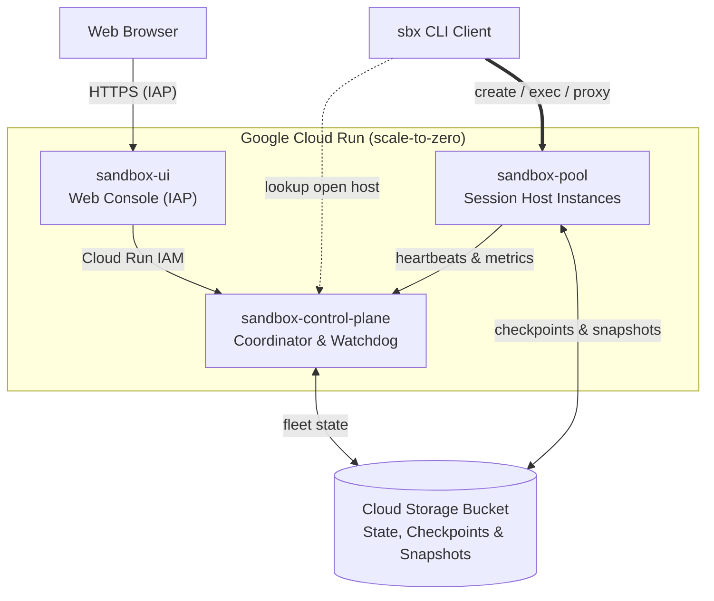

# Cloud Run Sandbox Dispenser (`sbx`)

[](go.mod)
[](ARCHITECTURE.md)
[](LICENSE)

**Cloud Run Sandbox Dispenser** (`sbx`) provisions stateful, scale-to-zero Linux and PostgreSQL 16
sandboxes on Google Cloud Run—with typically sub-second warm starts, live host migration,
point-in-time snapshots, and instant cloning. Built for AI agents, interactive dev environments,
and CI test runners.

* **How is `sbx` different?** Unlike stateless Cloud Run containers or managed sandbox services
  (E2B, Modal, Daytona Cloud), `sbx` runs inside **your own GCP project** with multi-sandbox
  bin-packing and live migration.
* **Status**: Experimental reference implementation (`v1.2.0` — CLI and HTTP API may evolve).

**Contents:** [Why `sbx`?](#why-sbx) · [Install & Setup](#install--setup) ·
[Your First Sandbox (30s)](#your-first-sandbox-30-seconds) · [Recipes](#core-workflow-recipes) ·
[Web Console](#web-console-ui) · [How It Works](#how-it-works) ·
[CLI Reference](#cli-command-reference) · [Teardown](#uninstall--teardown) ·
[FAQ](#faq--limitations) · [Docs](#documentation)

---

## Why `sbx`?

* **Fast warm starts & direct routing**: Warm sandboxes boot in typically <1s, and the CLI routes
  directly to the owning host without a central proxy bottleneck ([routing architecture](ARCHITECTURE.md)).
* **Survives host scale-downs & crashes**: Sandboxes outlive individual Cloud Run instances via
  automatic live migration during rollouts and watchdog recovery on host failure.
* **Multi-sandbox bin-packing & scale-to-zero**: Co-locates multiple sandboxes per Cloud Run host
  (default 10, configurable via `--max-density`), compacts sparse hosts, and scales to zero when idle.
* **Persistent rootfs overlay & PostgreSQL 16**: `--persistent` saves the writable root filesystem
  overlay (`/workspace`, `/persistent`, and installed packages) and PostgreSQL data to Cloud Storage.
* **IAM-authenticated Preview URLs & Wake-on-HTTP**: Expose HTTP/WebSocket ports (gated by Cloud Run
  IAM, not public) or local TCP tunnels (`sbx port-forward`) that auto-resume suspended sandboxes.
* **Snapshots, custom templates & cloning**: Start from built-in templates (`ubuntu`, `python`,
  `node`, `postgres`), capture snapshots, register custom templates, or clone sandboxes in place.
* **Live SSE streaming & overcommit guardrails**: Stream output in real time (`-s`), prevent host
  OOMs with proactive hot-host migration ([OVERLOAD_PROTECTION.md](OVERLOAD_PROTECTION.md)), and
  control egress (`--no-allow-egress`).

---

## Install & Setup

### Prerequisites

* **Go 1.23+ toolchain required** (no prebuilt release binaries yet; installs via `make install` or
  `go install`).
* **Google Cloud SDK (`gcloud`)** installed and authenticated (`gcloud auth login`).
* **A Google Cloud project** with billing enabled:
  * **To connect to an existing fleet (`sbx init`)**: `roles/run.invoker` on
    `sandbox-control-plane` and `sandbox-pool`.
  * **To deploy a new fleet (`sbx deploy`)**: `roles/run.admin`, `roles/storage.admin`,
    `roles/artifactregistry.admin`, `roles/cloudbuild.builds.editor`,
    `roles/iam.serviceAccountUser`, and `roles/iap.admin` (or Project `Editor`/`Owner`).
* **Optional — Cloud Run Sandbox Runtime**: Required for container-level isolation
  (`engine_type: cloudrun`, configured via `sandboxLauncher: true` in `service-pool.yaml`);
  otherwise `sandbox-pool` falls back to `local` mode (trusted workloads only; see
  [Isolation FAQ](#faq--limitations)).

### 1. Install the `sbx` CLI

Install from source (recommended):

```shell
git clone https://github.com/oded996/cloud-run-sandbox-dispenser.git
cd cloud-run-sandbox-dispenser
make install   # installs ./sbx into $GOBIN (or $(go env GOPATH)/bin)
export PATH="${GOBIN:-$(go env GOPATH | cut -d: -f1)/bin}:$PATH"   # add to ~/.bashrc if needed
```

Or install directly with `go install` (a dedicated `cmd/sbx` package entrypoint is planned):

```shell
go install github.com/oded996/cloud-run-sandbox-dispenser@latest
export PATH="${GOBIN:-$(go env GOPATH | cut -d: -f1)/bin}:$PATH"   # add to ~/.bashrc if needed
cloud-run-sandbox-dispenser version   # automatically creates the 'sbx' symlink on first run
```

### 2. Connect to a Fleet (`sbx init`) or Deploy Your Own (`sbx deploy`)

* **Option A — Connect to an existing fleet (`sbx init`)**:

  ```shell
  # Auto-discover sandbox-control-plane in your project (defaults to --region=us-west1)
  sbx init --project=my-gcp-project

  # Or connect directly by control-plane URL
  sbx init https://sandbox-control-plane-xxxxx-uw.a.run.app
  ```

* **Option B — Deploy a new fleet (`sbx deploy`, ~2–3 minutes)**:
  * **Provisions**: 3 scale-to-zero Cloud Run Gen2 services (`sandbox-control-plane`,
    `sandbox-pool`, and IAP-protected `sandbox-ui`), an Artifact Registry repo, and a GCS bucket.
  * **Idle cost**: `$0` compute when no sandboxes are running (you pay only for GCS storage).
  * **Auto-configures**: Enables required APIs, seeds IAM/IAP policies, and runs `sbx init`.

  ```shell
  # Enable required APIs (also run automatically by sbx deploy)
  gcloud services enable run.googleapis.com cloudbuild.googleapis.com \
    artifactregistry.googleapis.com storage.googleapis.com iap.googleapis.com \
    --project=my-gcp-project

  # Deploy with 4 vCPU / 8Gi per host (default region: us-west1, default --max-density=10)
  sbx deploy --project=my-gcp-project --host-cpu=4 --host-memory=8Gi
  ```

> **Note:** `sbx` caches service endpoints and `gcloud` OIDC tokens in `~/.cache/sbx/` and
> auto-detects your active `gcloud` project if `--project` is omitted.

### 3. Verify Your Setup

```shell
sbx version && sbx list && sbx stats
# sbx client v1.2.0 (server v1.2.0, min_client_version=1.0.0)
```

---

## Your First Sandbox (30 Seconds)

Create a sandbox, copy and run a script, open an interactive shell, and clean up:

```shell
# 1. Create a Python sandbox and capture its unique sandbox_id
SBX=$(sbx create demo --template=python -q)

# 2. Copy a local script into /workspace and run it (default exec timeout: 60s)
echo "print('Hello from Cloud Run!')" > hello.py
sbx cp hello.py "$SBX":/workspace/hello.py
sbx exec "$SBX" -- python3 /workspace/hello.py
# Hello from Cloud Run!

# 3. Open an interactive shell session (type 'exit' to leave)
sbx ssh "$SBX"

# 4. List active sandboxes (trimmed for display; also shows EPOCH/PERSISTENT/IDLE_TIMEOUT/…)
sbx list
# SANDBOX_ID                  NAME  STATUS   TEMPLATE  HOST_ID        …
# sbx-host-742e5bf0-a1b2c3d4  demo  RUNNING  python    host-742e5bf0  …

# 5. Delete the sandbox when done
sbx delete "$SBX"
```

---

## Core Workflow Recipes

### Recipe 1: Long-Running Persistent Sandbox with Idle Auto-Suspend

Pass `--persistent` to persist the rootfs overlay in GCS and `--auto-suspend` to checkpoint and
release compute after inactivity:

```shell
# Auto-suspend is off by default; enable it per sandbox (--auto-suspend=5m)
# or fleet-wide (sbx config set --default-idle-timeout=5m).
SBX=$(sbx create data-runner \
  --template=python \
  --cpu=2 --memory=2Gi \
  --auto-suspend=5m \
  --persistent -q)

# Resize CPU/RAM in place before a heavy step
sbx update "$SBX" --cpu=4 --memory=4Gi

# Manually suspend (checkpoints persisted overlay to GCS & frees host slot) and resume
sbx suspend "$SBX"
sbx resume "$SBX"   # any exec, cp, port-forward, or HTTP request to its preview URL also resumes

sbx delete "$SBX"
```

### Recipe 2: Real-Time SSE Output Streaming

Pass `--stream` (`-s`) to stream `stdout` and `stderr` lines in real time over Server-Sent Events:

```shell
SBX=$(sbx create stream-demo --template=python -q)

# Use --timeout=10m for long foreground commands (default is 60s), or -d for background jobs
sbx exec "$SBX" -s --timeout=2m -- sh -c 'for i in 1 2 3; do echo "step $i"; sleep 1; done'
# step 1
# step 2
# step 3

sbx delete "$SBX"
```

### Recipe 3: IAM-Protected Preview URLs, Wake-on-HTTP & TCP Port Forwarding

Expose a sandbox port over HTTPS (gated by Cloud Run IAM `roles/run.invoker`, not public) or
forward a local TCP port:

```shell
SBX=$(sbx create web-demo --template=python --persistent -q)

# Start a background HTTP server (-d); persisted so Wake-on-HTTP restarts it on resume
sbx exec "$SBX" -d -- python3 -m http.server 8000

# Get the preview URL and suspend the sandbox to release compute
PREVIEW_URL=$(sbx preview-url "$SBX" --port=8000)
sbx suspend "$SBX"

# Wake-on-HTTP: first request resumes $SBX from GCS, restarts the -d server, and returns 200 OK.
# Requires a Cloud Run identity token from a principal with roles/run.invoker:
curl -H "Authorization: Bearer $(gcloud auth print-identity-token)" "$PREVIEW_URL"

# Or forward local TCP port 18000 -> sandbox port 8000 (runs in foreground until Ctrl-C):
# sbx port-forward "$SBX" 18000:8000

sbx delete "$SBX"
```

### Recipe 4: Scale-to-Zero PostgreSQL 16 Sandbox

Boot an isolated PostgreSQL 16 instance whose database state survives suspend/resume, auto-suspend,
and live host migrations (`RPO=0`):

```shell
SBX=$(sbx create pg-dev \
  --template=postgres \
  --cpu=2 --memory=2Gi \
  --auto-suspend=5m \
  --persistent -q)

# Run SQL directly inside the sandbox (no local psql client required)
sbx exec "$SBX" -- psql -U postgres -d postgres -c \
  "CREATE TABLE items (id SERIAL PRIMARY KEY, name TEXT); \
   INSERT INTO items (name) VALUES ('alpha'), ('beta'); \
   SELECT * FROM items;"

# Optional: tunnel local port 15432 -> sandbox port 5432 for a local psql client or ORM.
# Auto-suspend only triggers after active exec and port-forward tunnels close.
sbx port-forward "$SBX" 15432:5432 &
PF_PID=$!
sleep 1
psql -h 127.0.0.1 -p 15432 -U postgres -d postgres -c "SELECT * FROM items;"
kill "$PF_PID"

sbx delete "$SBX"
```

### Recipe 5a: Point-in-Time Snapshots

Snapshot any sandbox (persistent or not) and boot new sandboxes from that point in time:

```shell
BASE=$(sbx create ml-base --template=python --persistent -q)
sbx exec "$BASE" --timeout=5m -- pip install -q numpy

sbx snapshot create "$BASE" --name=numpy-snap
RESTORED=$(sbx create ml-restored --from-snapshot=numpy-snap --persistent -q)
sbx exec "$RESTORED" -- python3 -c "import numpy; print(numpy.__version__)"
# 2.x.y
```

### Recipe 5b: Reusable Custom Templates

Promote a configured sandbox or snapshot into a team-wide template (continues from 5a):

```shell
# Snapshots $BASE and registers 'team-python' (template delete also removes its snap-tpl-* snapshot)
sbx template create team-python \
  --from-sandbox="$BASE" \
  --description="Python environment with NumPy pre-installed"

WORKER=$(sbx create worker-1 --template=team-python -q)
sbx exec "$WORKER" -- python3 -c "import numpy; print('worker ready:', numpy.__version__)"
# worker ready: 2.x.y
```

### Recipe 5c: Instant In-Place Cloning

Fork a running sandbox in place (continues from 5a; clones default to non-persistent unless
`--persistent` is passed):

```shell
CLONE=$(sbx copy "$BASE" experiment-branch --persistent -q)
sbx exec "$CLONE" -- python3 -c "import numpy; print('clone ready:', numpy.__version__)"
# clone ready: 2.x.y

# Clean up Recipe 5 sandboxes, template, and snapshot (template delete also removes snap-tpl-*)
sbx delete "$BASE" "$RESTORED" "$WORKER" "$CLONE"
sbx template delete team-python
sbx snapshot delete numpy-snap
```

---

## Web Console UI

Access the built-in Web Console on Cloud Run (behind Cloud IAP, URL printed by `sbx deploy`) or
launch it locally against your cached `~/.cache/sbx` credentials:

```shell
# Print the hosted Cloud IAP Web Console URL (change --region if deployed elsewhere)
gcloud run services describe sandbox-ui \
  --project="$(gcloud config get-value project)" --region=us-west1 --format='value(status.url)'

# Or run the Web Console locally on http://127.0.0.1:8080 (override with PORT=9090 sbx ui)
sbx ui
```

| Console Tab | Capabilities |
| :--- | :--- |
| **Overview & Metrics** | Live running/suspended counts, CPU/RAM overcommit gauges, host time-series charts, and sizing advice. |
| **Sandboxes & Exec** | Create, resize, suspend/resume, live-migrate, clone, snapshot, and stream interactive `exec` / `logs`. |
| **Host Instances** | Per-host slot and memory bars with one-click drain, bin-pack compaction, and crash-recovery testing. |
| **Config, Templates & IAM** | Tune density/overcommit thresholds, manage custom templates, and edit Cloud IAP / IAM access policies. |

---

## How It Works



* **Three Cloud Run services + Cloud Storage**:
  1. **`sandbox-pool`**: Session-affinity host instances that bin-pack multiple sandboxes per host
     and checkpoint persistent overlays to GCS.
  2. **`sandbox-control-plane`**: Coordinator that dispenses open candidate hosts, compacts sparse
     hosts, and recovers sandboxes if a host fails.
  3. **`sandbox-ui`**: Cloud IAP-protected Web Console and Backend-for-Frontend (BFF).
* **Direct `sandbox_id` routing vs. `name` resolution**: Passing the `sbx-<host>-<hex>` ID returned
  by `sbx create` routes directly to the owning host with zero control-plane lookup (and
  auto-reroutes across live migrations); passing a human-readable `name` resolves via the control
  plane and requires the name to be unique (see [ARCHITECTURE.md](ARCHITECTURE.md)).

---

## CLI Command Reference

Pass `--json` to any command for machine-readable JSON output, or `--help` for flag details (full
reference in [USER_GUIDE.md](USER_GUIDE.md)):

| Category | Command | Description |
| :--- | :--- | :--- |
| **Setup** | `sbx init [URL]` | Configure `~/.cache/sbx` from a control-plane URL or `--project` / `--region`. |
| **Setup** | `sbx deploy` | Build and deploy the 3 Cloud Run services + GCS bucket (`--project`, `--region`, `--bucket`, `--host-cpu`, `--host-memory`) and run `sbx init`. |
| **Setup** | `sbx version` | Print client version, server version, and minimum required client version. |
| **Lifecycle** | `sbx create [NAME]` | Create a sandbox (`--template`, `--cpu`, `--memory`, `--persistent`, `--auto-suspend`, `--env`, `--metadata`, `--no-allow-egress`, `--pinned`, `--from-snapshot`, `-q`). |
| **Lifecycle** | `sbx list` | List sandboxes (`--name`, `--prefix`, `--status=RUNNING\|SUSPENDED`). |
| **Lifecycle** | `sbx inspect ID` | Show full JSON metadata (including `engine_type`), resource usage, and host routing. |
| **Lifecycle** | `sbx update ID` | Resize `--cpu`, `--memory`, `--auto-suspend`, `--allow-egress`, `--env`, or `--metadata` in place. |
| **Lifecycle** | `sbx suspend ID` / `sbx resume ID` | Save the writable rootfs overlay to GCS and release the host slot (`suspend` / `stop`), or resume on a warm host (`resume` / `start`). |
| **Lifecycle** | `sbx delete ID [ID2...]` | Permanently delete one or more sandboxes and their persistent storage. |
| **Execution & I/O** | `sbx exec ID -- CMD...` | Run a command inside a sandbox (`--timeout=60` default; `--stream` / `-s`, `--background` / `-d`, `--workdir`, `--env`, `--allow-egress`). |
| **Execution & I/O** | `sbx ssh ID` | Open an interactive shell session inside a sandbox. |
| **Execution & I/O** | `sbx cp SRC DST` | Copy files between the local machine and `ID:/remote/path`. |
| **Execution & I/O** | `sbx logs ID` | View command execution and lifecycle logs (`--tail=N`). |
| **Networking** | `sbx preview-url ID` | Print the IAM-gated HTTP/WebSocket preview URL (`/proxy/ID/PORT/`) for `--port=8000` and `--path=/`. |
| **Networking** | `sbx port-forward ID L:R` | Forward local TCP port `L` to remote port `R` inside the sandbox. |
| **Cloning & Images** | `sbx copy SRC NEW_NAME` | Clone a running sandbox in place (`--persistent`, `--target-host`, `-q`). |
| **Cloning & Images** | `sbx snapshot create\|list\|delete` | Create (`--name`, `--force`), list, or delete point-in-time sandbox snapshots. |
| **Cloning & Images** | `sbx template list\|create\|delete` | Manage built-in and custom snapshot-backed templates (`--from-sandbox`, `--from-snapshot`). |
| **Fleet & Ops** | `sbx migrate ID` | Live-migrate a single sandbox (`--to-host`) or drain an entire host (`--host=HOST_ID`). |
| **Fleet & Ops** | `sbx hosts list\|drain\|compact` | Inspect active host instances, drain a host, trigger bin-pack compaction, or `simulate-crash`. |
| **Fleet & Ops** | `sbx stats` / `sbx metrics` | View fleet SLA summary, CPU/RAM overcommit ratios, `--history`, and sizing recommendations. |
| **Fleet & Ops** | `sbx config get\|set` | View or update fleet-wide density, host CPU/RAM, default idle timeout, and overload thresholds. |
| **Web Console** | `sbx ui` | Run the Web Console BFF locally on `http://127.0.0.1:8080` (`PORT=9090 sbx ui`). |

**Command Aliases:** `ls` (`list`), `rm` (`delete`), `describe` (`inspect`), `fork` (`copy`),
`stop` (`suspend`), `start` (`resume`), `preview` (`preview-url`), `forward` (`port-forward`),
`templates` (`template`).

---

## Uninstall / Teardown

To remove a deployed fleet and its storage from your Google Cloud project:

```shell
PROJECT="$(gcloud config get-value project)"
REGION="us-west1"                        # change if deployed to another region
BUCKET="${PROJECT}-sandbox-dispenser"    # or your custom --bucket name if overridden

for svc in sandbox-ui sandbox-pool sandbox-control-plane; do
  gcloud run services delete "$svc" --project="$PROJECT" --region="$REGION" --quiet
done
gcloud artifacts repositories delete sandbox-dispenser \
  --project="$PROJECT" --location="$REGION" --quiet
gcloud storage rm -r "gs://${BUCKET}"
# Optional: remove Cloud Build's default staging bucket if not used by other builds in $PROJECT:
# gcloud storage rm -r "gs://${PROJECT}_cloudbuild"
rm -rf ~/.cache/sbx
```

---

## FAQ & Limitations

* **What is the isolation model (`cloudrun` vs. `local`)?**
  * With the **Cloud Run Sandbox Runtime** (`engine_type: cloudrun`, detected via
    `/usr/local/gcp/bin/sandbox` and `/run/gcp/sandbox/sandbox.sock`), each sandbox runs in an
    isolated container with its own rootfs overlay, namespaces, cgroup limits, and egress rules
    (check via `sbx inspect <ID>`).

  > [!WARNING]
  > Without the Cloud Run Sandbox Runtime socket (`/run/gcp/sandbox/sandbox.sock`), `sandbox-pool`
  > falls back to `engine_type: local` (`LocalProcessEngine`), which provides `chmod 0700`
  > directory separation in a shared container without per-sandbox namespaces or enforced CPU/RAM
  > limits. `--max-density=1` gives each sandbox its own Cloud Run instance, but in `local` mode
  > code still shares the container (and service-account identity) with `hostd`. Use `cloudrun`
  > mode for untrusted code.

* **How does pricing / scale-to-zero work?** When all sandboxes are deleted or `SUSPENDED`, all
  three Cloud Run services scale to zero instances (`minScale: 0`), so you pay only for Cloud
  Storage of persisted overlays and snapshots. While sandboxes run, co-located sandboxes share warm
  `sandbox-pool` host instances.
* **What happens to long-running foreground `sbx exec` commands?** Foreground `sbx exec` calls
  default to `--timeout=60` (60 seconds). Pass `--timeout=10m` (or any duration) for longer
  foreground builds/installs, or `-d` (`--background`) for daemons and background jobs that should
  run until stopped.
* **What are the sandbox size and overcommit limits?** Each sandbox is capped by the underlying
  `sandbox-pool` host size (configurable up to Cloud Run Gen2 maximums such as `8 vCPU / 32Gi` via
  `sbx deploy` or `sbx config set`). Co-located sandboxes can overcommit host memory up to
  `max_memory_overcommit_ratio` (default `2.0x`), guarded by memory-aware admission control and
  proactive hot-host live migration.

---

## Documentation

* **[User Guide & CLI Reference (USER_GUIDE.md)](USER_GUIDE.md)** — Complete flag-by-flag CLI
  reference, authentication details, Web Console operations, and cookbook recipes.
* **[Overcommit & Overload Protection Guide (OVERLOAD_PROTECTION.md)](OVERLOAD_PROTECTION.md)** —
  Cloud Run cgroup v2 memory limits, `sbx metrics`, admission control, and proactive hot-host live
  migration.
* **[Architecture & Maintainer Guide (ARCHITECTURE.md)](ARCHITECTURE.md)** — Three-service Cloud Run
  topology, decentralized session routing, two-tier GCS consistency model, and source layout.

---

## Contributing & License

Contributions, bug reports, and feature requests are welcome! Build and verify changes locally with
`make build` and `make test`. See [CONTRIBUTING.md](CONTRIBUTING.md) for development workflow,
[Google CLA](https://cla.developers.google.com/) requirements, and community guidelines.

Licensed under the [Apache License, Version 2.0](LICENSE).

*Disclaimer: This is not an officially supported Google product.*
